# PicHub 详细设计文档

> 版本：v1.0
> 对应代码版本：`main` 分支（Go 1.24 / Gin 1.10 / GORM 1.25 / MySQL 8 / Redis 7 / Vue 3）
> 文档定位：**按现有实现反写的详细设计（Design as Implemented）**，用于开发维护、问题定位、二次开发与评审。

---

## 1. 文档说明

### 1.1 目的

`docs/` 下已有两份面向使用者的文档，本文件补齐**面向实现**的一层：

| 文档 | 视角 | 内容 | 何时阅读 |
| --- | --- | --- | --- |
| `desc/design.md` | 产品 / 概要设计 | 需求、功能清单、技术选型、DDL、目录规划 | 了解"要做什么" |
| `docs/api.md` | 接口使用 | 每个 HTTP 接口的入参、出参、错误、示例 | 对接前端 / 第三方 |
| `docs/openapi.yaml` | 接口契约 | OpenAPI 3.0.3 机器可读描述 | 生成 SDK、自动化测试 |
| **`docs/design.md`（本文件）** | **实现设计** | 组件划分、调用链、并发与事务边界、流程图与时序图、关键取舍 | 改代码 / 排障 / 评审 |

本文件中的流程、时序、常量、默认值**全部来自源码核对**，与代码不一致处以代码为准。

### 1.2 读者与前置知识

- 后端开发：需要熟悉 Go、Gin、GORM、Redis。
- 运维：关注第 4 章（生命周期）、第 13 章（异步与定时）、第 14 章（横切）。
- 安全评审：关注第 6、9、12、14.5 章。

### 1.3 术语

| 术语 | 含义 |
| --- | --- |
| **Hash** | 文件内容的 SHA-256 十六进制串（64 字符），既是去重键也是图片短链标识 |
| **StorageKey** | 对象在具体存储驱动中的路径（本地相对路径 / S3 ObjectKey / WebDAV 路径） |
| **Strategy** | 一条存储策略记录（驱动类型 + 配置 + 密钥），对应 `storages` 表 |
| **Secret** | 策略中的敏感字段（AK/SK、密码），AES-GCM 加密后落库 |
| **Asset URL** | 对外展示的图片地址，`/i/{hash}.{ext}` 或驱动的 `PublicURL` |
| **直出** | 通过 `/i/:hash`、`/t/:hash/:size` 直接返回图片字节，不经过业务 API |
| **秒传** | 命中已存在 Hash 时跳过字节落盘，仅插入新记录 |
| **RefCount** | 物理文件引用计数，多个 `images` 记录可共享同一物理文件 |
| **Scope** | API Token 的权限位：`upload` / `read` / `write` / `delete` / `stats` |
| **Buffer** | 访问来源（Referer）的进程内聚合缓冲，定期刷入 Redis |
| **S3 网关** | PicHub 自实现的 S3 兼容入口，供 PicGo / PicList 等客户端直传 |

### 1.4 图中约定

- 流程图使用 `flowchart TD`，菱形为判定，圆角为起止，数据库形状 `[( )]` 表示持久化。
- 时序图使用 `sequenceDiagram`，参与者为**包/组件名**（如 `Handler`、`Service`、`Repo`、`MySQL`、`Redis`）。
- 标注「异步」的分支表示不阻塞主调用链。

---

## 2. 系统概述

### 2.1 形态

PicHub 是**单二进制自托管图床**：Go 后端 + Vue 3 前端（`go:embed` 打包进二进制），外加 MySQL 与 Redis 两个外部依赖。启动一个进程即提供：

1. Web 管理界面与 REST API（`/api/v1`）
2. 图片直出与动态处理（`/i`、`/t`）
3. S3 兼容网关（`/s3`）
4. 内置任务队列消费者与定时任务调度器（无独立 worker 进程）

### 2.2 技术栈

| 层次 | 选型 | 版本 | 用途 |
| --- | --- | --- | --- |
| 语言 | Go | 1.24.0 | 全部后端 |
| HTTP | gin-gonic/gin | v1.10.0 | 路由、中间件、参数绑定 |
| ORM | gorm.io/gorm + gorm.io/driver/mysql | v1.25.10 / v1.6.0 | 数据访问 |
| 缓存 | redis/go-redis/v9 | v9.5.3 | 限流、Token 黑名单、验证码、引用缓冲、任务队列 |
| 鉴权 | golang-jwt/jwt/v5 | v5.2.1 | JWT 签发与校验 |
| 校验 | go-playground/validator/v10 | v10.27.0 | 请求体校验 |
| 日志 | go.uber.org/zap + lumberjack | v1.27.0 | 结构化日志、日志轮转 |
| 配置 | spf13/viper | v1.21.0 | YAML 加载 + 默认值 |
| 验证码 | mojocn/base64Captcha | v1.3.8 | 图形验证码 |
| 图像 | disintegration/imaging | v1.6.2 | 缩放、裁剪、模糊、灰度、水印 |
| WebP | gen2brain/webp | v0.6.4 | WebP 编解码（纯 Go，无 CGO） |
| 云存储 | aws-sdk-go-v2/service/s3 | v1.58.0 | S3 驱动 |
| WebDAV | studio-b12/gowebdav | v0.10.0 | WebDAV 驱动 |
| 邮件 | net/smtp（标准库封装） | — | 验证邮件、找回密码 |
| 前端 | Vue 3 + Vite + TypeScript + Element Plus | — | 管理界面，构建产物嵌入二进制 |
| 文档 | Swagger / OpenAPI 3.0.3 | — | `docs/openapi.yaml` |

> 未使用 CGO：`gen2brain/webp` 在 linux/amd64、linux/arm64、darwin/arm64 等平台为纯 Go 实现，因此二进制可静态编译。

### 2.3 运行时依赖与端口

| 依赖 | 必需 | 用途 | 缺失时行为 |
| --- | --- | --- | --- |
| MySQL 8 | 是 | 全部业务数据 | 启动失败 |
| Redis 7 | 是 | 限流/缓存/队列 | 启动失败；运行期部分功能降级（限流放行、缓存 miss） |
| 本地磁盘 | 是 | 本地存储驱动、图片处理缓存、分片临时文件 | 启动失败（目录不可写时） |
| SMTP | 否 | 邮箱验证、找回密码 | 注册走 `soft` 模式，邮件功能关闭 |
| 对象存储 / WebDAV | 否 | 远端存储驱动 | 对应策略不可用，回退本地 |

---

## 3. 总体架构

### 3.1 组件视图

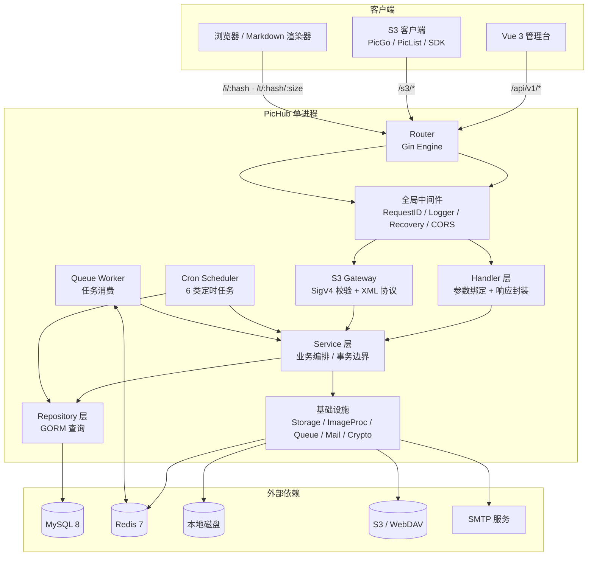

### 3.2 分层与依赖方向

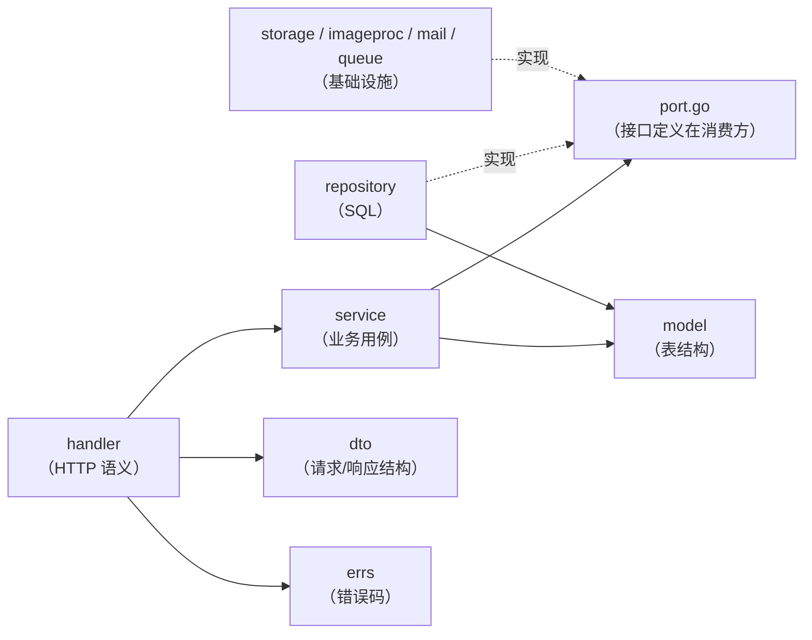

约束：

- **handler 不碰 gorm**，只做绑定、调用 service、写响应。
- **service 不碰 `*gin.Context`**（除极少量读取原始请求场景，如上传需要 `io.Reader`），统一收 `context.Context`。
- **repository 不返回业务错误码**，只返回 `nil` / `gorm.ErrRecordNotFound` / 原生 error，由 service 翻译为 `errs`。
- 接口定义在消费方（`service/port.go`、`storage/manager.StrategyRepo`），便于替换与测试。

### 3.3 包职责

| 包 | 职责 | 关键文件 |
| --- | --- | --- |
| `cmd/pichub` | 入口，解析 `-c` 配置文件路径 | `main.go` |
| `internal/bootstrap` | 依赖装配、DB/Redis 连接、迁移、优雅关闭 | `app.go`、`db.go`、`redis.go`、`migrate.go` |
| `internal/config` | 配置结构、默认值、加载、密钥派生、校验 | `config.go`、`defaults.go`、`load.go`、`secret.go`、`validate.go` |
| `internal/router` | 路由注册与分组、限流装配 | `router.go`、`api.go`、`image.go`、`static.go` |
| `internal/middleware` | 认证、管理员、Scope、限流、日志、恢复、CORS、RequestID | 同名文件 |
| `internal/handler` | HTTP 处理器 | 16 个 handler 文件 |
| `internal/service` | 业务编排 | `upload.go`、`image.go`、`auth.go`、`s3gw` 相关方法等 |
| `internal/repository` | 数据访问与事务 | `image_repo.go`、`user_repo.go`、`transaction.go` |
| `internal/model` | 表结构 | `image.go`、`user.go`、`base.go` |
| `internal/storage` | 存储抽象与驱动 | `storage.go`、`local/`、`s3/`、`webdav/`、`manager/` |
| `internal/imageproc` | 解码、变换、编码、磁盘缓存 | `processor.go`、`transform.go`、`cache.go` |
| `internal/s3gw` | S3 协议实现 | `handler.go`、`sigv4.go`、`multipart.go`、`errors.go` |
| `internal/queue` | Redis 队列与消费者 | `redis_queue.go`、`worker.go` |
| `internal/cron` | 定时任务 | `scheduler.go`、`jobs.go` |
| `internal/cache` | Redis 侧能力封装 | `ratelimit.go`、`captcha.go`、`referer_buffer.go` |
| `internal/auth` | JWT 与密码 | `jwt.go`、`password.go` |
| `internal/crypto` | AES-GCM 加解密 | `aes.go` |
| `internal/mail` | SMTP 发送与模板 | `smtp.go`、`sender.go` |
| `internal/errs` | 错误码与错误类型 | `code.go`、`error.go` |
| `internal/logger` | zap 初始化与字段构造 | `logger.go` |
| `internal/web` | 前端静态资源嵌入 | `embed.go`、`noembed.go` |

### 3.4 路由总览

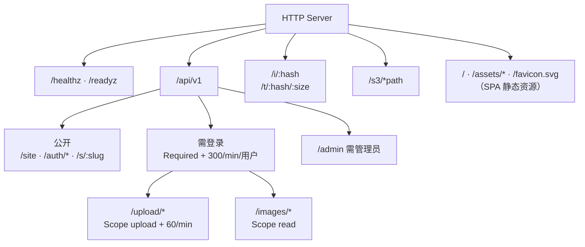

| 分组 | 前缀 | 认证 | 限流 | 说明 |
| --- | --- | --- | --- | --- |
| 健康检查 | `/healthz`、`/readyz` | 无 | 无 | 探针；`readyz` 检查 DB + Redis |
| 站点配置 | `/api/v1/site` | 无 | 无 | 返回站点名、验证码开关、上传限制等 |
| 认证 | `/api/v1/auth/*` | 无 | `register` 10/小时/IP；`login` 10/分钟/IP | 其余认证接口不限流 |
| 分享访问 | `/api/v1/s/:slug` | 无 | 无 | 可能返回密码挑战 |
| 登录态接口 | `/api/v1/**`（除上面） | JWT 或 API Token | 300/分钟/用户 | 上传另有 60/分钟 |
| 管理端 | `/api/v1/admin/**` | 管理员 | 300/分钟/用户 | 无 Scope 限制（API Token 无法访问） |
| 图片直出 | `/i`、`/t` | 视图片可见性 | IP 维度（`img` 限额） | 支持签名 URL |
| S3 网关 | `/s3` | SigV4 / 匿名（仅公开图） | 无 | 开关由 `system_settings` 控制 |

> 限流数值均来自 `config/defaults.go`，可被 YAML 覆盖。

### 3.5 中间件链

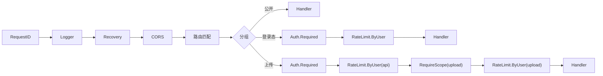

顺序要点：

1. `RequestID` 最先，保证后续日志、错误响应、S3 `RequestId` 都能取到。
2. `Recovery` 在业务之前，panic 转为 500 并记录堆栈，不泄露内部细节到响应。
3. 认证先于限流：限流 Key 需要 `userID`，匿名时退化为 IP。
4. **Scope 校验先于上传限流**：避免无 `upload` 权限的 Token 消耗上传配额桶。

---

## 4. 运行生命周期

### 4.1 启动装配顺序

`bootstrap.New` 采用**显式顺序装配**（非依赖注入框架），顺序不可随意调整：

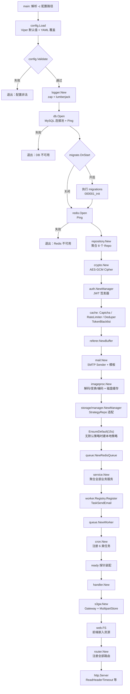

装配期间的关键动作：

| 步骤 | 说明 | 失败策略 |
| --- | --- | --- |
| `config.Validate` | 校验端口、DSN、JWT 密钥长度等 | 直接退出 |
| `migrate.OnStart` | 执行 `migrations/*.up.sql`，失败即退出 | 直接退出（避免半初始化） |
| `storage/manager.EnsureDefault` | 15s 超时；无默认策略时用 YAML 的本地配置建一条 | 超时仅告警，不影响启动 |
| `worker.Registry.Register` | 注册 `email:send` 任务处理器 | 未注册的任务会进死信 |
| `s3gw.New` | 读取 `site_name` 作为 `HostId` | 配置读取失败时留空 |

### 4.2 启动时序

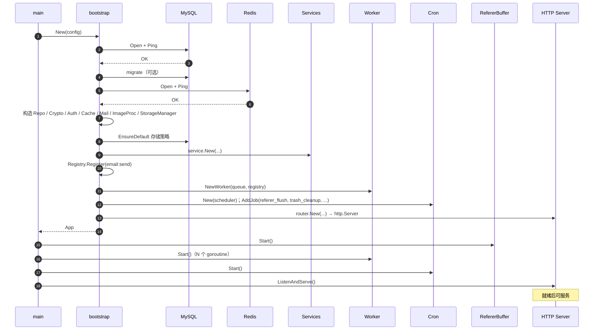

### 4.3 优雅关闭

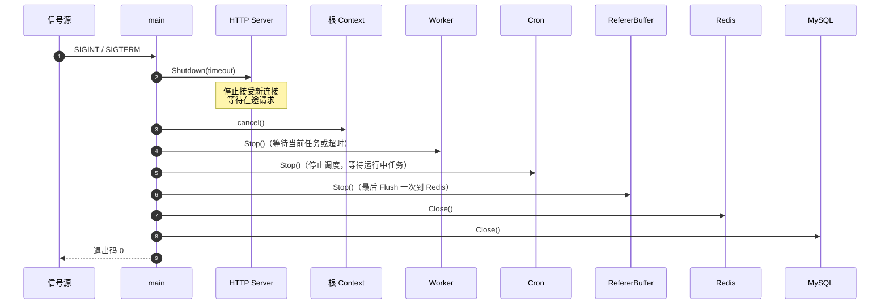

顺序设计意图：

1. **先停 HTTP**：避免关闭过程中仍有新请求写入 DB/Redis。
2. **再 cancel 根 Context**：让在途的耗时操作（远程下载、队列任务）尽早退出。
3. **Worker/Cron 在 Redis 关闭之前停止**：保证停止过程仍可写回结果与死信。
4. **Buffer 最后 Flush**：尽最大努力把内存里尚未落 Redis 的引用计数写出（上限为一次批量写）。

### 4.4 就绪与存活探针

| 探针 | 路径 | 成功 | 失败 | 用途 |
| --- | --- | --- | --- | --- |
| 存活 | `GET /healthz` | `200 {"status":"ok"}` | — | 进程存活即通过，不探测依赖 |
| 就绪 | `GET /readyz` | `200 {"status":"ok"}` | `503 {"status":"unavailable","error":"..."}` | DB `Ping` + Redis `Ping` 均通过才就绪 |

设计取舍：`healthz` **不检查依赖**，避免 DB 抖动导致容器被反复重启（重启无法修复依赖故障）；`readyz` 检查依赖，用于负载均衡摘除流量。

---

## 5. 数据模型

### 5.1 ER 图（主干）

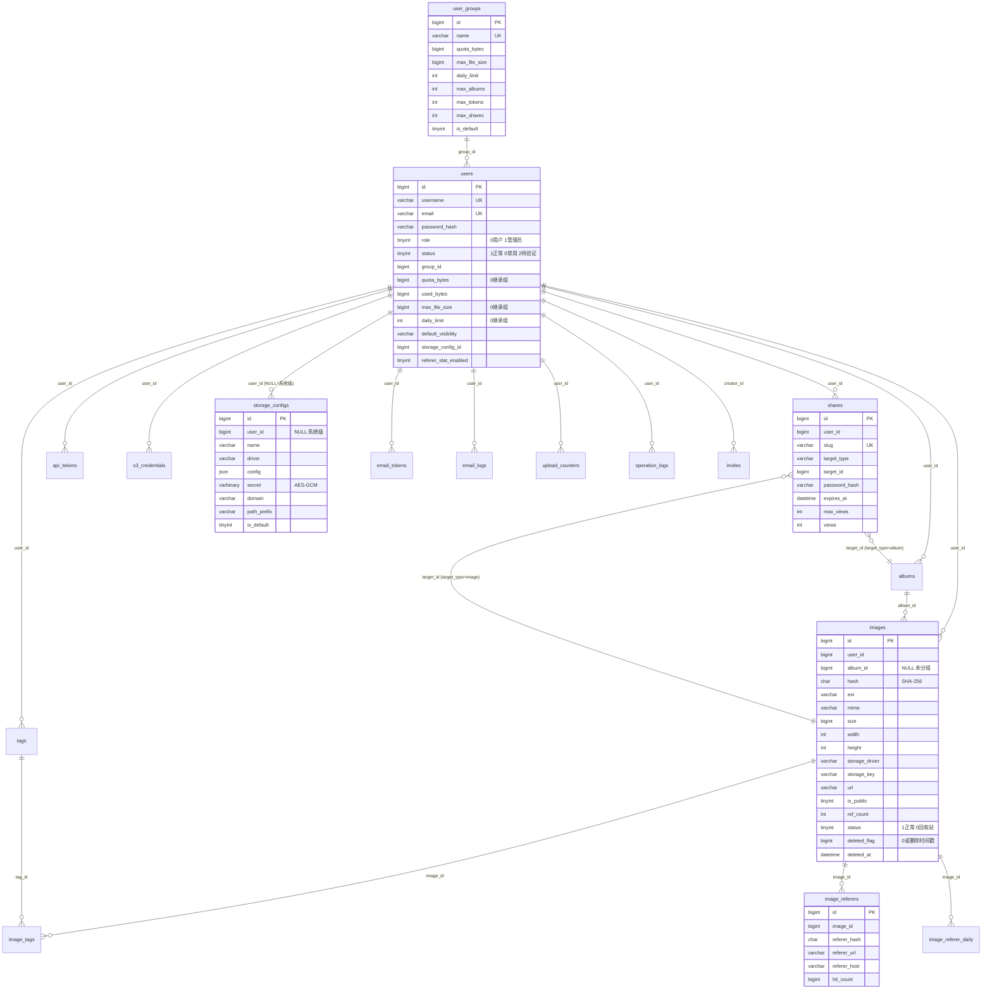

> `shares.target_id` 为多态外键（`target_type` 区分），数据库层不建外键约束。

### 5.2 表清单

| 表 | 作用 | 关键索引 / 约束 | 备注 |
| --- | --- | --- | --- |
| `user_groups` | 配额与权限模板 | `uk_name`、`idx_is_default(is_default,status)` | 初始化 4 个组 |
| `users` | 账号 | `uk_username`、`uk_email`、`idx_register_ip` | 用户名唯一性大小写不敏感（排序规则） |
| `email_tokens` | 邮箱验证 / 重置令牌 | `uk_token_hash`、`idx_expires` | 只存 SHA-256，明文仅在邮件链接中 |
| `email_logs` | 邮件发送记录 | `idx_status_created` | 每日发送量据此统计 |
| `api_tokens` | API 访问令牌 | `uk_token_hash`、`idx_user(user_id,status)` | 明文仅创建时返回一次 |
| `s3_credentials` | S3 网关凭据 | `uk_access_key` | Secret 用 AES-GCM 加密 |
| `storage_configs` | 存储策略 | `idx_user`、`idx_default` | `user_id IS NULL` 为系统级 |
| `albums` | 相册 | `idx_user_sort` | `image_count` 冗余计数 |
| `images` | 图片元数据（核心表） | `uk_user_hash_alive(user_id,hash,deleted_flag)`、`idx_user_created`、`idx_hash`、`idx_status_del` | 见 5.4 |
| `tags` | 标签 | `uk_user_name` | `image_count` 冗余计数 |
| `image_tags` | 图片-标签关联 | `PK(image_id,tag_id)`、`idx_tag` | 多对多 |
| `shares` | 分享链接 | `uk_slug`、`idx_target` | `slug` 为 5 字节随机可读串 |
| `image_referers` | 引用来源累计 | `uk_img_ref(image_id,referer_hash)` | 唯一键保证 upsert 幂等 |
| `image_referer_daily` | 引用按天聚合 | `PK(image_id,stat_date,referer_host)` | 默认保留 180 天 |
| `upload_counters` | 每日上传张数/字节 | `PK(user_id,stat_date)` | 日限额与统计的数据源 |
| `operation_logs` | 审计日志 | `idx_user_created`、`idx_action_created` | 默认保留 90 天 |
| `system_settings` | 运行期可改配置 | `uk_cfg_key` | 覆盖 YAML，1 分钟缓存 |
| `invites` | 邀请码 | `uk_code` | `max_uses` / `used_count` 控制可用次数 |

### 5.3 全局约定

1. **时间统一 UTC**：所有 `DATETIME(3)` 存 UTC，时区转换仅在前端进行。
2. **无数据库外键**：删除/一致性由 service 保证，避免分库与批量清理受限。
3. **时间精度毫秒**：`DATETIME(3)`，排序/游标分页使用 `id DESC` 保证稳定。
4. **软删除**：`images` 用 `status + deleted_at + deleted_flag` 三元组表达回收站。
5. **敏感字段**：`password_hash`、`token_hash`、`storage_key`、`thumb_key` 的 JSON tag 均为 `-`，永不出现在 API 响应中。

### 5.4 `images` 表的三个关键设计

**（1）秒传兼容的弱唯一约束**

```sql
UNIQUE KEY `uk_user_hash_alive` (`user_id`, `hash`, `deleted_flag`)
```

- 同一用户同一 Hash 只能有**一条存活记录**（`deleted_flag = 0`）。
- 删除时把 `deleted_flag` 写成 UnixNano 时间戳，于是唯一键被"让位"，同一文件可再次上传而不会冲突。
- 回收站中可存在多条同 Hash 历史记录（不同 `deleted_flag`），各自独立恢复/清理。
- 物理文件不重复：`ref_count` 记录共享同一 `storage_key` 的记录数，最后一个引用消失时才删除对象。

**（2）冗余计数**

| 冗余字段 | 维护位置 | 作用 |
| --- | --- | --- |
| `albums.image_count` | 上传成功后 +1；移动/删除相册归属时同步 | 避免列表页 `COUNT(*)` |
| `tags.image_count` | 打标签/删标签时同步 | 标签云展示 |
| `users.used_bytes` | `AddUsedBytes` / `SubUsedBytes`，条件更新 | 配额判断，**SQL 原子** |
| `upload_counters.count/bytes` | 上传事务内 upsert | 日限额与统计图 |

**（3）存储字段**

| 字段 | 含义 | 前端可见 |
| --- | --- | --- |
| `storage_driver` | 驱动名（`local`/`s3`/`webdav`） | 是 |
| `storage_key` | 驱动内路径 | 否（`json:"-"`） |
| `thumb_key` | 预生成缩略图路径 | 否（`json:"-"`） |
| `url` | 对外访问地址（驱动 `PublicURL` 或 `/i/{hash}.{ext}`） | 是 |

---

## 6. 认证与授权

### 6.1 三条凭据通道

| 通道 | 凭据形态 | 用途 | 存储方式 | 有效期 | 校验位置 |
| --- | --- | --- | --- | --- | --- |
| **JWT** | `Authorization: Bearer <access>` | Web 前端 | 无状态 + Redis 黑名单（`jti`） | access 2h / refresh 168h | `middleware.Auth` |
| **API Token** | `Authorization: Bearer ph_xxx` | 脚本 / 第三方 | 仅存 `sha256`，`token_prefix` 供展示 | 可设 1-3650 天或永久 | `middleware.Auth` → `ValidateAPIToken` |
| **S3 凭据** | SigV4 `Authorization: AWS4-HMAC-SHA256 ...` | S3 客户端 | AK 明文索引，SK 用 AES-GCM 加密 | 不过期（可禁用） | `s3gw` → `ValidateS3Credential` |

隔离点：中间件看到 Token 以 `ph_` 开头即走 API Token 分支，不再尝试 JWT 解析；S3 网关是**独立路由**，从不经过 JWT 中间件。

### 6.2 请求鉴权流程

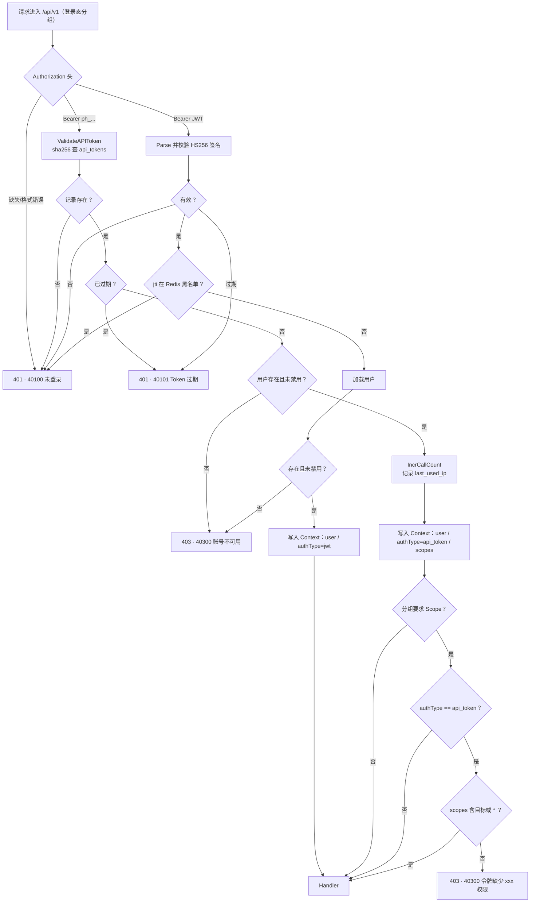

`Optional` 变体（用于公开接口读取可选登录态）在无凭据时**不中断**，只留空 `user`。

### 6.3 JWT 声明结构

| 字段 | 含义 | 备注 |
| --- | --- | --- |
| `sub` / `user_id` | 用户 ID | 中间件据此加载用户 |
| `role` | 角色（0 用户 / 1 管理员） | 仅用于前端展示，**权限判断以 DB 现值为准** |
| `jti` | 令牌唯一 ID | 注销/轮换时写入黑名单，TTL = 剩余有效期 |
| `exp` / `iat` / `nbf` | 签发与过期时间 | access 2h、refresh 168h（可配） |

黑名单键：`jwt:blacklist:<jti>`，Value 为占位，TTL 取 Token 剩余有效期，过期自动清理。

### 6.4 注册流程

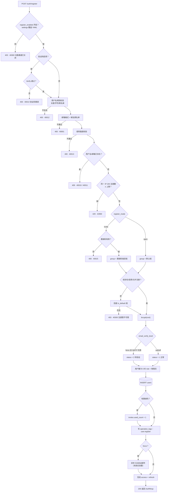

实现细节：

- `email_verified` 仅在 `level == "off"` 时为 `true`；`soft` 模式下用户可用但功能受限（按需在业务处校验）。
- `force` 但 SMTP 未配置时，`emailVerifyLevel` **自动降级为 soft**，避免用户永久无法登录。
- 邀请码次数自增在用户创建**之后**执行；并发超发时只记警告日志，不回滚已注册用户。

### 6.5 登录流程

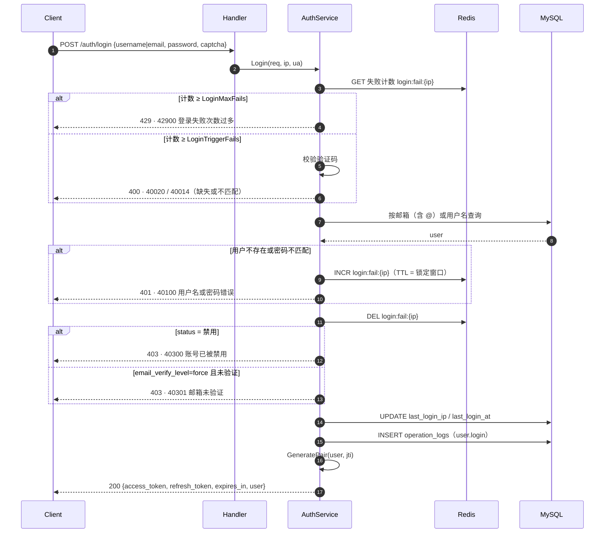

- 失败窗口 TTL 默认 10 分钟（`login_lock_duration`），计数达到 `login_max_fails`（默认 5）后即使密码正确也拒绝。
- 校验顺序为「先查状态再验密码」的**反向**实现：先验密码再查状态，避免通过 403 探测"账号存在且被禁用"。

### 6.6 刷新与注销

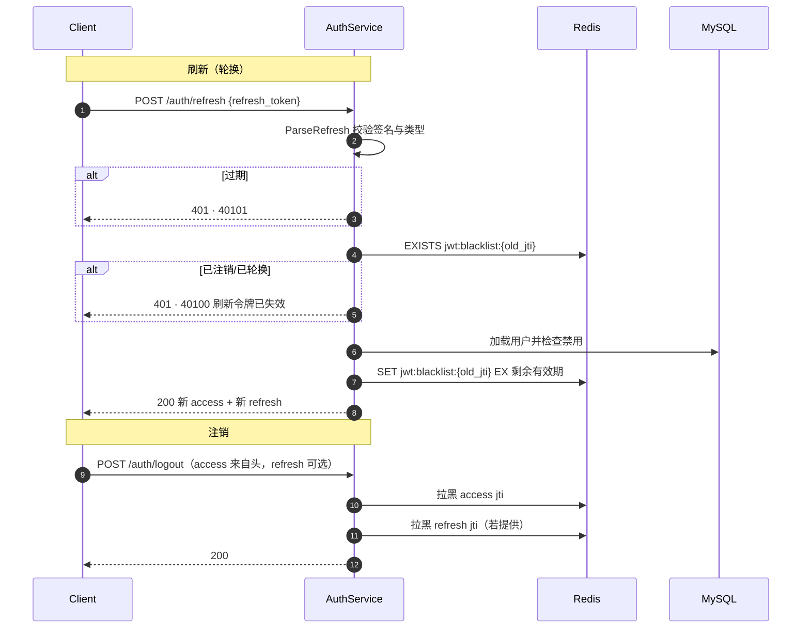

刷新采用**一次性轮换**：旧 refresh 立即失效，可检测令牌被盗用后的重放（重放返回 401）。注销接口在 token 已过期时依然幂等成功。

### 6.7 邮箱验证与密码重置

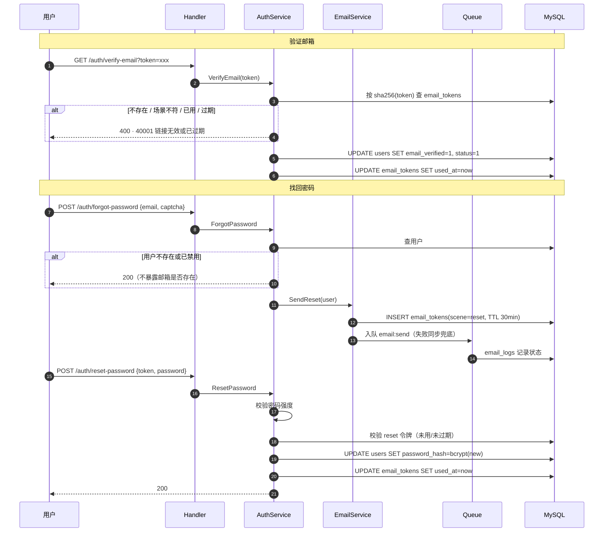

- 令牌只存哈希（`CHAR(64)`），明文仅存在于邮件链接中，DB 泄露无法直接使用。
- `verify` 令牌 TTL 24h，`reset` 令牌 TTL 30min。
- 重置密码**不会**拉黑该用户已有的 JWT；如需强制下线，需额外机制（见 16 章扩展点）。

### 6.8 API Token

创建时生成 `ph_` + 随机串，返回明文一次；DB 存 `sha256` 与展示前缀。

| Scope | 实际生效范围 | 说明 |
| --- | --- | --- |
| `upload` | `/api/v1/upload/**` | 单图、秒传检测、远程 URL、分片 |
| `read` | `/api/v1/images/**` | 列表、详情、回收站、引用统计 |
| `write` | 当前无独立挂载点 | 预留（`PATCH /images/:id` 仍在 `read` 组内） |
| `delete` | 当前无独立挂载点 | 预留 |
| `stats` | 当前无独立挂载点 | 预留 |
| `*` | 全部 | 中间件支持通配 |

> 事实说明：当前版本仅在 `/upload`（`upload`）与 `/images`（`read`）两个分组挂载了 `RequireScope`。其余登录态接口（相册、标签、Token、分享、存储）只要求**有效凭据**，不区分 Scope。这是有意为之的简化，未列入 `scopes` 的权限位为**前向兼容预留**。

限制与行为：

- 每个用户 Token 数量受 `max_tokens` 约束（`0` 不限）。
- `expires_in_days` 上限 3650，`0` 表示永久。
- 每次成功校验都会 `IncrCallCount` 并写 `last_used_ip`（失败不影响请求）。
- 删除/禁用后立即失效（每次请求都查 DB，无本地缓存）。

### 6.9 授权矩阵

| 资源 | 本人 | 其他登录用户 | 管理员 | API Token |
| --- | --- | --- | --- | --- |
| 自己的图片 | 全部操作 | 不可见（仅公开图可直出） | 可见，管理操作受限 | 需 `read`/`upload` |
| 相册 | 全部操作 | 不可见 | 可见 | 需有效凭据 |
| 存储策略 | 仅当组 `allow_custom_storage=1` | — | 全部（含系统级） | 需有效凭据 |
| 系统配置 | — | — | 读写 | 不可访问（`RequireAdmin`） |
| 其他用户 | — | — | 列表/禁用/改组/重置密码 | 不可访问 |

---

## 7. 上传链路

### 7.1 四条入口

| 入口 | 路由 | 服务方法 | 字节来源 | 典型场景 |
| --- | --- | --- | --- | --- |
| 单图 | `POST /api/v1/upload` | `Upload` | `multipart/form-data` | Web 拖拽、PicGo |
| 秒传检测 | `POST /api/v1/upload/check` | `Check` | 无（仅 Hash） | 上传前预检 |
| 远程拉取 | `POST /api/v1/upload/url` | `UploadURL` | HTTP GET | 转存外链 |
| 分片 | `POST /upload/chunk/init` → `POST /upload/chunk/:id` → `POST /upload/chunk/:id/complete` | `ChunkInit` / `UploadPart` / `ChunkComplete` | 多段 | 大文件、弱网 |
| S3 网关 | `PUT /s3/pichub/{key}` | `UploadObject` | 请求体 | S3 客户端 |

四个入口最终都汇入 `persist`，因此**权限、配额、去重、事务、标签**的行为完全一致；差异只在于"字节如何到达临时文件"与"存储 Key 是否由客户端指定"。

### 7.2 统一落库流程（`persist`）

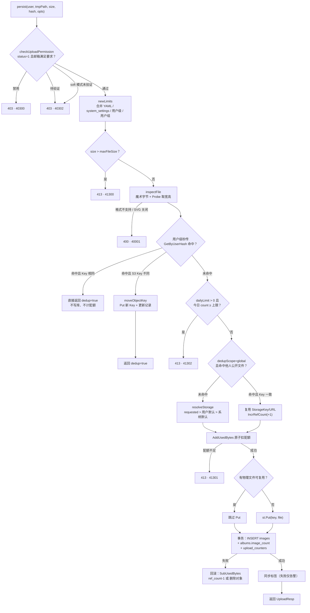

**顺序不可调换的原因**：

| 步骤 | 为什么在这个位置 |
| --- | --- |
| 权限 → 限额 | 限额解析要读用户组，无权限的请求没必要查库 |
| 秒传 → 日限额 | 秒传不产生新的存储与计数，若先判日限额会把重复上传误拦 |
| 日限额 → 全局秒传 | 全局秒传仍会新增一条记录并计入日计数，必须在限额之后 |
| 配额 → 写对象 | 先扣配额再加锁存储，避免"写成功但配额不足"产生孤儿文件 |
| 写对象 → 事务 | 对象先落地，DB 事务失败时删对象即可；反过来会产生"记录存在但文件缺失" |
| 标签 → 事务之后 | 标签失败不应导致上传失败（弱一致） |

### 7.3 单图上传时序

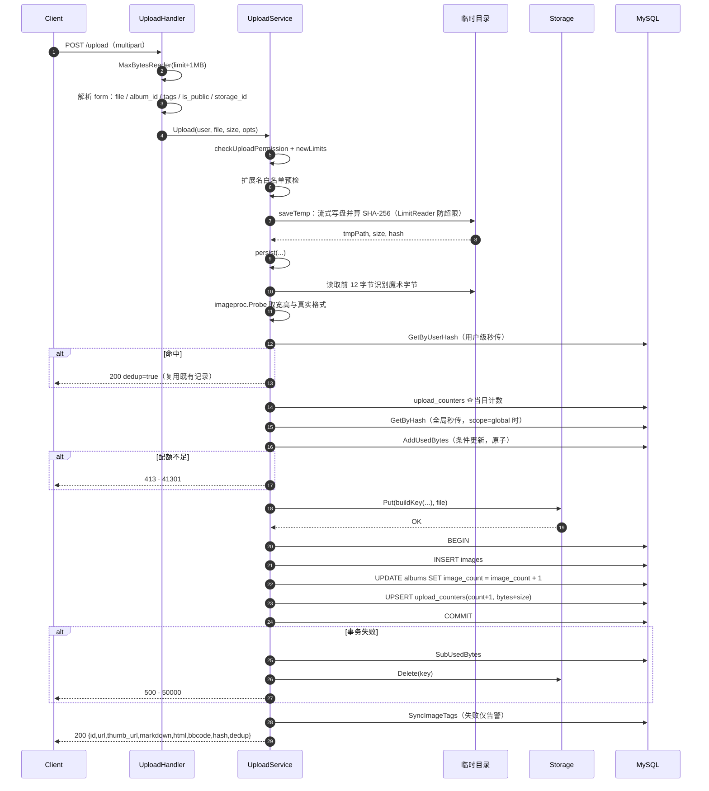

### 7.4 秒传判定

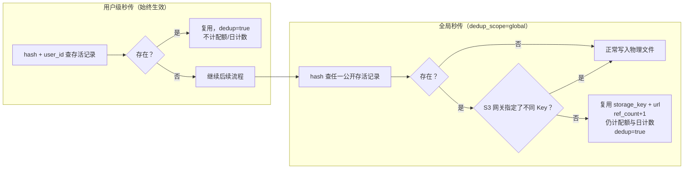

关键语义差异：

| 维度 | 用户级秒传 | 全局秒传 |
| --- | --- | --- |
| 触发条件 | 同用户同 Hash 存活记录 | `dedup_scope=global` 且他人已有该 Hash |
| 是否新增记录 | **否**，直接返回已有记录 | 是，新建一条记录指向同一物理文件 |
| 是否计日上传数 | 否 | 是 |
| 是否计 `used_bytes` | 否 | 是（逻辑配额按记录计） |
| 是否影响 `ref_count` | 否 | 是（+1） |
| S3 Key 冲突 | 同 Key 直接复用；不同 Key 走 `moveObjectKey` | Key 不同则**放弃复用**，正常写入 |

`moveObjectKey` 用于 S3 网关"内容相同但对象 Key 不同"的场景：先把新 Key 写入存储，再更新既有记录的 `storage_key/driver/url`，更新失败则删除新对象。**旧 Key 的对象不会被删除**（保守策略，避免误删被其它记录引用的文件）。

### 7.5 分片上传时序

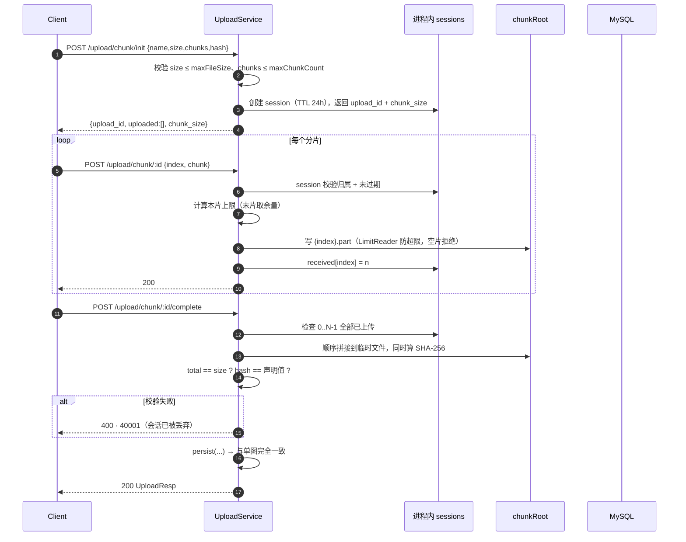

设计取舍与限制：

- **会话存在进程内存**（`map[string]*chunkSession` + `sync.Mutex`）：单实例部署简单高效；多实例需粘性会话或改造为 Redis/DB 存储（见 16 章）。
- 会话 TTL 24h，`ChunkInit` 时会顺带清理过期会话；`cache_cleanup` 定时任务调用 `CleanupChunks(now-24h)` 清理磁盘残留。
- `ChunkComplete` 使用 `defer dropSession`：**无论成功失败都会删除分片目录**，避免半成品堆积；代价是失败后必须重新初始化。
- 分片默认 5MB、最多 1000 片，末片允许小于分片大小但对超出严格拒绝。

### 7.6 远程 URL 转存

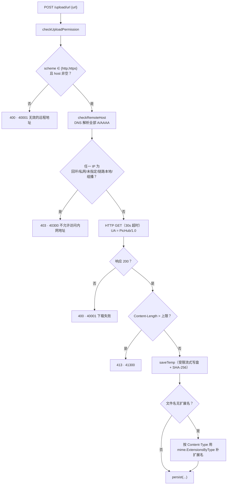

SSRF 防护要点：

1. **禁止重定向**（`CheckRedirect` 返回 `ErrUseLastResponse`）：否则可 302 到内网。
2. **先解析再连接**：校验发生在发请求之前，覆盖 IPv4/IPv6。
3. **Content-Length 预检 + LimitReader 双重限制**：防止伪造长度或分块传输绕过。
4. 显式 `User-Agent`，便于对端识别与回溯。

> 已知边界：DNS 校验与实际连接之间存在 TOCTOU 窗口（DNS Rebinding）。若需强防护应改为自定义 `DialContext` 在连接层校验 IP。

### 7.7 限额解析优先级

| 限额 | 优先级（高 → 低） | 代码位置 |
| --- | --- | --- |
| `max_file_size` | `users.max_file_size` > `upload.max_file_size`（默认 10MB） | `newLimits` |
| `daily_limit` | `users.daily_limit` > `user_groups.daily_limit` > 不限 | `newLimits` |
| 允许扩展名 | `system_settings.upload.allowed_extensions` > `upload.allowed_extensions` > 内置 9 种 | `newLimits` |
| `allow_svg` | `upload.allow_svg`（全局，无用户级开关） | `newLimits` + `inspectFile` |
| 默认可见性 | `users.default_visibility` > `system_settings.upload.default_visibility` > `public` | `newLimits` |
| 去重策略 | `upload.dedup_enabled` + `upload.dedup_scope`（`user` / `global`） | `newLimits` |
| 分片大小 / 片数 | `upload.chunk_size`（5MB）/ `upload.max_chunk_count`（1000） | `chunkSize` / `ChunkInit` |
| 配额 | `users.quota_bytes`（`0` 表示不限，注册时复制组配额） | `AddUsedBytes` |

扩展名归一化规则：`jpeg → jpg`、`tif → tiff`、大小写不敏感、去前导点；`svg` 在 `allow_svg=false` 时无论白名单如何一律拒绝。

### 7.8 失败回滚矩阵

| 失败点 | 已发生的副作用 | 回滚动作 |
| --- | --- | --- |
| `saveTemp` 超限 | 临时文件 | 删除临时文件 |
| `inspectFile` 失败 | 临时文件 | 调用方 `defer os.Remove(tmp)` |
| `GetByHash` 命中但 Key 不同 | 新 Key 已 Put | 更新记录失败时 `st.Delete(newKey)` |
| `AddUsedBytes` 失败 | 无 | 直接返回 413 |
| `st.Put` 失败 | `used_bytes` 已 +size | `SubUsedBytes` |
| `IncrRefCount` 失败 | `used_bytes` 已 +size | `SubUsedBytes` |
| 事务失败（复用分支） | `used_bytes` +size，`ref_count` +1 | `SubUsedBytes` + `IncrRefCount(-1)` |
| 事务失败（新对象分支） | `used_bytes` +size，对象已存在 | `SubUsedBytes` + `st.Delete(key)` |
| 标签同步失败 | 图片已成功 | 不回滚，只记 `Warn` |
| 操作日志写入失败 | 业务已成功 | 不回滚（`logOp` 内部吞错） |

> 回滚使用 `context.Background()`：即使请求 Context 已取消，回滚也要执行完毕，避免资源泄漏。

### 7.9 存储 Key 与访问 URL

**Key 模板**（`storage_configs.config.path_template` > `storage.local.path_template` > 默认）：

```
{prefix}/{yyyy}/{MM}/{dd}/{hash2}/{hash}.{ext}
```

| 占位符 | 含义 | 示例 |
| --- | --- | --- |
| `{prefix}` | 策略 `path_prefix`，缺省 `uploads` | `uploads` |
| `{yyyy}` / `{MM}` / `{dd}` | UTC 年 / 月 / 日 | `2026` / `10` / `25` |
| `{hh}` / `{mm}` / `{ss}` | 时 / 分 / 秒 | `14` / `03` / `27` |
| `{hash}` | 完整 SHA-256 | `9f86d0...` |
| `{hash2}` | Hash 前 2 位 | `9f` |
| `{ext}` | 归一化扩展名 | `jpg` |
| `{user_id}` | 用户 ID | `42` |

生成后做 `ToSlash` + 去前导 `/` + 折叠重复 `/`。S3 网关路径会先经 `normalizeObjectKey`（`path.Clean` 去除 `..`、长度 ≤ 480、空 Key 拒绝）。

**URL 规则**：

| 驱动 | `images.url` |
| --- | --- |
| `local` | `site_url + "/i/" + hash + "." + ext` |
| `s3` / `webdav` | 驱动 `PublicURL(key)`；为空时回退 `/i/` 形式 |

> 即使远端驱动配置了 CDN 域名，`/i/` 直出依然可用（服务端回源读取），确保私有图与防盗链可控。

---

## 8. 存储抽象

### 8.1 接口定义

```go
// Storage 是所有存储驱动必须实现的最小契约。
type Storage interface {
    Driver() string
    Put(ctx context.Context, key string, r io.Reader, size int64, contentType string) error
    Get(ctx context.Context, key string) (io.ReadCloser, *FileInfo, error)
    Stat(ctx context.Context, key string) (*FileInfo, error)
    Delete(ctx context.Context, key string) error
    PublicURL(key string) string
    Test(ctx context.Context) error
}

// LocalPathProvider 是可选能力：本地驱动可直接给出文件路径，
// 让直出/水印等场景走零拷贝的 http.ServeContent。
type LocalPathProvider interface {
    LocalPath(key string) (string, bool)
}
```

设计意图：

- **最小接口**：新增驱动只需实现 7 个方法，不必关心业务。
- **可选能力用接口断言**：`LocalPathProvider` 让本地驱动支持 `Range`/`Sendfile`，远端驱动自然走流式拷贝。
- **不抽象列举/签名 URL**：S3 的列举语义与本地目录差异过大，S3 网关直接查 DB（`images` 表）而不是查驱动。

### 8.2 驱动矩阵

| 驱动 | 实现 | 配置要点 | `PublicURL` | 说明 |
| --- | --- | --- | --- | --- |
| `local` | `storage/local` | `root_path`、`path_prefix`、`path_template` | 由 `domain` 拼接，为空则 `/i/` | 默认驱动，支持 `LocalPath` |
| `s3` | `storage/s3` | `endpoint`、`region`、`bucket`、`path_style`、`use_ssl`、`public_url` | `public_url` / `domain` + key | AWS SDK v2 |
| `oss` | `storage/s3` | 同 `s3`（Endpoint 填 OSS 地址） | 同上 | S3 兼容协议复用 |
| `cos` | `storage/s3` | 同 `s3`（Endpoint 填 COS 地址） | 同上 | S3 兼容协议复用 |
| `webdav` | `storage/webdav` | `url`、`username`、`password`、`public_url` | `public_url` / `domain` + key | `gowebdav` |

### 8.3 策略解析

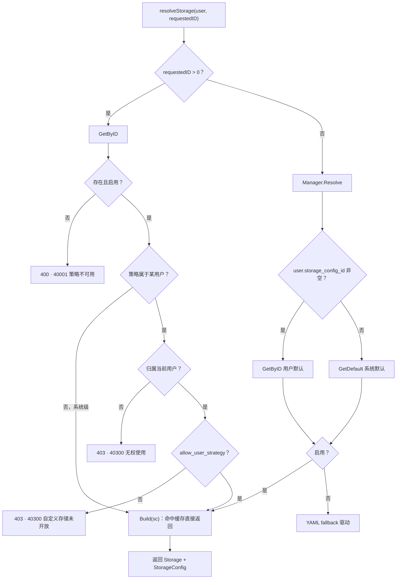

### 8.4 驱动缓存与失效

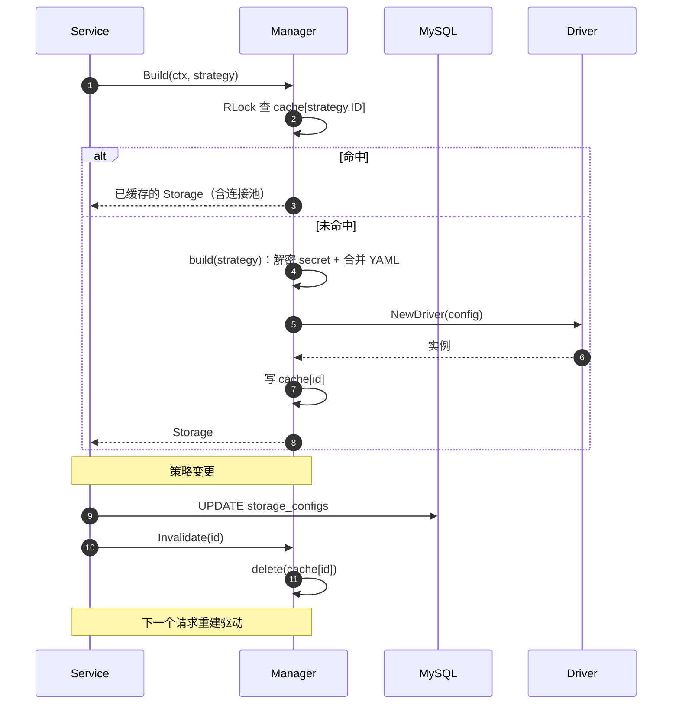

- 缓存键为**策略 ID**，因此同一策略被多用户引用时共享一个驱动实例。
- `Test(strategy)` **不写缓存**（用 `build` 而非 `Build`），避免把临时/错误的配置固化。
- 缓存无 TTL：策略更新由管理接口显式 `Invalidate`，进程重启自然清空。

### 8.5 敏感配置加密

```mermaid
flowchart LR
    A["明文 Secret 结构体"] --> B["json.Marshal"]
    B --> C["AES-256-GCM<br/>随机 nonce"]
    C --> D[("storage_configs.secret<br/>VARBINARY(1024)")]
    D --> E["Decrypt"]
    E --> F["json.Unmarshal"]
    F --> G["DriverConfig"]
```

| 约定 | 说明 |
| --- | --- |
| 密钥来源 | `security.encryption_key`（未配置时由 `jwt_secret` 派生，见 `config/secret.go`） |
| 加密范围 | `access_key`、`secret_key`、`password`；非敏感项（endpoint/bucket 等）存 `config` JSON 明文 |
| 本地驱动 | **不读取** Secret；启动时 `cleanupLocalSecret` 清理历史版本的非法占位密钥 |
| 解密失败 | 直接报错（`decrypt storage secret`），不做静默降级，避免用错凭据写坏数据 |
| 密钥轮换 | 不支持热轮换；更换加密密钥后需重填所有策略的 Secret |

### 8.6 本地驱动的可靠性细节

| 关注点 | 实现 |
| --- | --- |
| 路径穿越 | `absPath` 拼接后校验 `filepath.Rel(root, abs)` 不以 `..` 开头 |
| 原子写入 | 写 `<key>.tmp` → `Sync()` → `Chmod(0644)` → `Rename()` |
| 目录创建 | `MkdirAll(dir, 0755)`，失败返回明确错误 |
| 读取 | 先 `Stat` 再 `Open`，不存在返回 `storage.ErrNotFound`（供上层映射 404） |
| 连通性测试 | `Test` 在 root 下写入并删除探针文件 |
| 删除 | `os.Remove`，文件不存在视为成功（幂等） |

> 原子写入保证"半截文件"不会被直出读到；`Rename` 在同一文件系统内是原子操作，这也是为什么 `.tmp` 必须与目标同目录。

---

## 9. 图片访问与处理（直出）

### 9.1 路由与参数

| 路由 | 用途 | 关键查询参数 |
| --- | --- | --- |
| `GET /i/:hash` | 原图或动态处理 | `w`、`h`、`fit`、`q`、`format`、`blur`、`gray`、`uid`、`exp`、`sign` |
| `GET /t/:hash/:size` | 预设缩略图 | `uid`、`exp`、`sign`；`:size` 可为 `small` / `medium` / `large` / 数字宽度（可带扩展名） |

`:hash` 允许携带图片扩展名（`.jpg` 等），服务端会剥离；非法/空 Hash 返回 404。

### 9.2 总流程

```mermaid
flowchart TD
    A["GET /i/:hash"] --> B{"防盗链通过？"}
    B -->|否| X1["403 或 302 到站点首页"]
    B -->|是| C["剥离扩展名得到 hash"]
    C --> D{"含动态参数？"}
    D -->|否| E["serveOriginal"]
    D -->|是| F["ParseOptions"]
    F -->|参数非法| X2["400 · 40001"]
    F --> G{"need == true？"}
    G -->|否（仅 gray=0 等无效值）| E
    G -->|是| H{"动态处理启用？"}
    H -->|否| X3["404 动态处理未启用"]
    H -->|是| I["accessible：找图 + 可见性校验"]
    I --> J["RenderCached：缓存命中直接返回"]
    J --> K["writeProcessed：ETag/304/7 天缓存"]

    E --> L["DeliverOriginal：accessible + 打开对象"]
    L --> M["Referer.Record（异步）"]
    M --> N{"If-None-Match 含 hash？"}
    N -->|是| O["304"]
    N -->|否| P["本地 ServeContent / 远端流式拷贝"]
```

### 9.3 原图直出时序

```mermaid
sequenceDiagram
    autonumber
    participant B as 浏览器
    participant H as ImageOutHandler
    participant S as ImageService
    participant DB as MySQL
    participant ST as Storage
    participant RF as RefererBuffer
    participant RD as Redis

    B->>H: GET /i/{hash}.jpg
    H->>H: checkAntiLeech（Referer 白名单）
    H->>S: DeliverOriginal(hash, uid, exp, sign)
    S->>DB: GetByHash（公开且未删）
    alt 未命中
        S->>DB: GetByHashAny（含私有/回收站判定）
    end
    alt 私有图且非本人
        S->>S: VerifyURLSign(secret, hash, exp, sign)
        alt 签名无效
            S-->>B: 403 · 40300 图片不可访问
        end
    end
    S->>ST: LocalPath（本地）或 Get（远端）
    ST-->>S: 文件句柄 / 流
    S-->>H: Delivery{Image, LocalPath|Reader}
    H->>RF: Record(image, Referer, UA)  %% 非阻塞
    RF-->>RD: HINCRBY ref:buf:YYYYMMDD
    H->>B: 200 + ETag + Cache-Control
    alt 本地
        H->>B: http.ServeContent（支持 Range）
    else 远端
        H->>B: io.Copy 流式传输
    end
```

### 9.4 动态处理参数

| 参数 | 取值范围 | 默认 | 说明 |
| --- | --- | --- | --- |
| `w` | 1 - `max_width`（默认 4096），超出截断 | 0（按高度自适应） | 目标宽度 |
| `h` | 1 - `max_height`（默认 4096），超出截断 | 0（按宽度自适应） | 目标高度 |
| `fit` | `cover` / `contain` / `fill` / `inside` / `outside` | `inside` | 缩放模式 |
| `q` | 1 - 100 | 85（`dynamic.default_quality`） | 编码质量 |
| `format` | `webp` / `jpeg` / `png` / `avif`（受 `allowed_formats` 限制） | 跟随源格式 | 输出格式 |
| `blur` | 0 - 100（内部除以 10，夹取 0.3 - 20） | 0 | 高斯模糊 sigma |
| `gray` | `1` / `true` / `yes` | false | 灰度 |

处理链：`Probe`（取元数据） → 像素炸弹检查（≤ 1 亿像素） → `Decode` → `Transform`（缩放/模糊/灰度/水印） → `Encode`（按 `outputFormat`） → 写缓存。

```mermaid
flowchart LR
    A["源图字节"] --> B{"像素 > 1e8？"}
    B -->|是| X1["413 图片尺寸过大"]
    B -->|否| C{"SVG？"}
    C -->|是| X2["400 该格式不支持处理"]
    C -->|否| D["Decode"]
    D --> E["Transform<br/>Resize → Blur → Gray → Watermark"]
    E --> F["outputFormat<br/>请求格式 > 源格式 > jpeg"]
    F --> G{"CanEncode？"}
    G -->|否| H["降级 jpeg"]
    G -->|是| I["Encode(quality)"]
    H --> I
    I --> J[("磁盘缓存<br/>dir/ab/&lt;key&gt;.&lt;ext&gt;")]
```

### 9.5 缩略图

- 尺寸名映射到配置的 `image.thumbnail.sizes`（默认 `small=200`、`medium=800`、`large=1600`），也可直接传数字宽度。
- 缩略图固定 `fit=inside`、`no_upscale=true`，默认输出 `webp`（`quality=82`）。
- `thumb_url` 取**中间尺寸**（配置数组的中位数），保证列表页带宽与清晰度平衡。
- 未启用缩略图时 `/t/...` 返回 404，`thumb_url` 字段为空字符串。

### 9.6 私有图签名

```
sign = hex( HMAC-SHA256( secret, hash + ":" + exp ) )
url  = /i/{hash}.{ext}?uid={ownerID}&exp={unix}&sign={sign}
```

| 项 | 规则 |
| --- | --- |
| `secret` | `security.url_sign_secret`，为空时回退 `security.jwt_secret` |
| `exp` | Unix 秒；`exp <= 0` 视为无效 |
| 过期判定 | `now > exp` 即拒绝 |
| 比较方式 | `hmac.Equal`（常量时间，防时序侧信道） |
| 放行条件 | 图片 `is_public=1`，或请求 `uid == image.user_id`，或签名有效 |

注意：`uid` 仅用于"本人访问"判定，**不参与签名计算**；这意味着签名对任意 `uid` 都有效，但不会因此泄露权限（`uid` 只影响是否走本人放行）。

### 9.7 缓存头与条件请求

| 响应类型 | `Cache-Control` | `ETag` | 说明 |
| --- | --- | --- | --- |
| 公开原图 | `public, max-age=31536000, immutable` | `"{hash}"` | 内容由 Hash 唯一决定，永久可缓存 |
| 私有原图 | `private, max-age=3600` | `"{hash}"` | 禁止中间代理缓存 |
| 处理后图片 | `public, max-age=604800` | `"{hash}\|{optKey}"` | 7 天；optKey 编码全部参数 |
| 缩略图 | `public, max-age=604800` | `"{hash}\|{size}"` | 同上 |

所有图片响应都带 `X-Content-Type-Options: nosniff`。`If-None-Match` 用**子串包含**判断（兼容 `W/` 前缀与多值），命中返回 `304` 且不写正文。

### 9.8 防盗链

```mermaid
flowchart TD
    A["请求 /i 或 /t"] --> B{"anti_leech.enabled？"}
    B -->|否| OK["放行"]
    B -->|是| C{"Referer 为空？"}
    C -->|是| D{"allow_empty_referer？"}
    D -->|是| OK
    D -->|否| DENY
    C -->|否| E["解析 Hostname"]
    E -->|解析失败| DENY
    E --> F{"等于站点域名<br/>或是其子域？"}
    F -->|是| OK
    F -->|否| G{"匹配白名单后缀？"}
    G -->|是| OK
    G -->|否| DENY{"block_action"}
    DENY -->|forbidden| X["403 · 40300"]
    DENY -->|其他（默认）| Y["302 → 站点首页"]
```

白名单匹配规则：去前导 `.`、小写、支持子域后缀（`img.example.com` 命中 `example.com`）。

### 9.9 处理结果磁盘缓存

| 项 | 规则 |
| --- | --- |
| 目录布局 | `{cache_dir}/{key[0:2]}/{key}.{ext}`，两级散列避免单目录过多文件 |
| Key | `sha256("v1\|{hash}.{ext}\|{optKey}")` |
| 命中 | `Get` 返回数据并刷新 `mtime`（LRU 近似） |
| 写入 | 先写临时文件再 `rename`，保证读到的是完整文件 |
| 容量控制 | 超过 `cache_max_size`（默认 10GB）按 `mtime` 淘汰至 90% |
| 过期 | `cache_ttl` 默认 168h，由 `cache_cleanup` 定时任务清理 |
| 版本失效 | 处理逻辑变更时递增 `cacheKeyVersion`，旧缓存自然淘汰 |

---

## 10. 引用来源统计

### 10.1 采集链路

出口只有一处：`/i/:hash` 原图直出成功打开文件后调用 `Referer.Record`。它不阻塞响应，也不参与事务。

```mermaid
flowchart TD
    A["图片请求成功打开文件"] --> B{"全局 referer.enabled？"}
    B -->|否| Z["丢弃"]
    B -->|是| C{"用户 referer_stat_enabled？<br/>（5 分钟内存缓存）"}
    C -->|否| Z
    C -->|是| D{"Referer 非空？"}
    D -->|否| Z
    D -->|是| E{"可解析出 Hostname？"}
    E -->|否| Z
    E --> F{"是自身域名或其子域？"}
    F -->|是| Z
    F -->|否| G{"exclude_bots 且 UA 命中 bot？"}
    G -->|是| Z
    G -->|否| H["计算 referer_hash = sha256(完整 URL)"]
    H --> I{"channel 未满？"}
    I -->|否| Z2["丢弃并 dropped+1<br/>（只计数，不阻塞）"]
    I -->|是| J["Push 到 RefererBuffer"]
```

过滤设计：

| 过滤项 | 目的 |
| --- | --- |
| 空 Referer | 直接访问 / 客户端工具不计入"引用" |
| 自身域名及子域 | 站内浏览不产生外部引用 |
| Bot UA | 已知爬虫会伪造 Referer，统计噪声大；关键词表可配置 |
| 用户开关 | 允许用户关闭统计（`referer_stat_enabled`），避免隐私顾虑 |

`userEnabled` 有 5 分钟进程内缓存（`map[userID]{enabled, at}`），用户改开关后调用 `InvalidateUser` 失效；避免每次图片请求都查 `users` 表。

### 10.2 缓冲与落库

```mermaid
sequenceDiagram
    autonumber
    participant H as ImageOutHandler
    participant RF as RefererService
    participant BUF as RefererBuffer
    participant RD as Redis
    participant CR as Cron(referer_flush)
    participant DB as MySQL

    H->>RF: Record(image, Referer, UA)
    RF->>RF: 过滤 + sha256
    RF->>BUF: Push（非阻塞，满则丢弃）
    Note over H: 图片响应继续，不等统计
    BUF->>RD: Pipeline: HINCRBY ref:buf:YYYYMMDD "imageID|hash" 1<br/>SET ref:meta:hash "url\0host" EX 48h

    loop 每分钟
        CR->>RF: Flush(ctx)
        RF->>RD: EVAL HGETALL + DEL（原子取走）
        RD-->>RF: [[field, count], ...]
        RF->>RD: GET ref:meta:hash 补全 URL/Host
        RF->>DB: UPSERT image_referers（hit_count += n）
        RF->>DB: UPSERT image_referer_daily（按天累加）
    end
```

**为什么中间加一层 Redis HASH**：

1. 图片直出是最高频路径，直接写 MySQL 会放大写压力（一次页面可能触发几十张图）。
2. Redis `HINCRBY` 把同一 `(image, referer)` 的 N 次命中压成 1 次 DB 写。
3. `HGETALL + DEL` 用 Lua 保证"取走即清空"，多个实例并发 flush 不会重复累加。
4. `meta` 键存 URL/Host 明细，TTL 48h——即使计数在当日刷盘后仍有后续命中，也能补全展示字段。

### 10.3 Redis 结构

| Key | 类型 | 内容 | TTL |
| --- | --- | --- | --- |
| `{prefix}ref:buf:YYYYMMDD` | HASH | field = `{imageID}\|{refererHash}`，value = 命中次数 | 无（由 Flush 删除） |
| `{prefix}ref:meta:{refererHash}` | STRING | `url\x00host` | 48h |

`prefix` 来自 `redis.key_prefix`，便于多实例共用一个 Redis 时隔离。

### 10.4 落库与查询

| 操作 | 语义 |
| --- | --- |
| `UpsertBatch(image_referers)` | `ON DUPLICATE KEY UPDATE hit_count = hit_count + VALUES(...)`，唯一键 `(image_id, referer_hash)` 保证幂等 |
| `UpsertDailyBatch(image_referer_daily)` | 主键 `(image_id, stat_date, referer_host)` 累加，按 UTC 日期 |
| `TopHosts(userID, days, limit)` | 聚合某用户最近 N 天的域名排行，`limit` 上限 100，`days` 上限 365 |
| `Trend(userID, days)` | 按天返回总命中数，用于趋势图 |
| `Summary(imageID)` | 单图总命中数 + 来源域名数 |
| `Delete(refererID, imageID)` | 用户手动删除某条来源记录（带归属校验） |
| `CleanupDaily` | 删除 `stat_date < today - daily_retain_days` 的聚合数据（配置默认 180 天，代码兜底 90） |

数据量控制：`image_referers` 只增不减（用户可手删），`image_referer_daily` 按保留天数滚动删除。查询侧始终按 `image_id` 或 `stat_date` 命中索引，不做全表扫描。

---

## 11. 分享链接

### 11.1 创建

```mermaid
flowchart TD
    A["POST /shares {target_type, target_id}"] --> B{"target_type"}
    B -->|image| B1{"图片存在且属于本人<br/>且 status=1？"}
    B1 -->|否| X1["404 · 40400"]
    B -->|album| B2{"相册存在且属于本人？"}
    B2 -->|否| X1
    B -->|其他| X2["400 · 40001"]
    B1 -->|是| C
    B2 -->|是| C{"组 max_shares 上限？"}
    C -->|已达上限| X3["403 · 40300 分享数量已达上限"]
    C -->|未超| D["处理可选参数"]
    D --> D1["max_views：负数归一为 0（不限）"]
    D --> D2["expires_in_hours：上限 8760（1 年）"]
    D --> D3["password：4-32 位，bcrypt 哈希"]
    D1 --> E["生成 slug<br/>NewOpaqueToken(5) 冲突重试 ≤ 10 次"]
    D2 --> E
    D3 --> E
    E -->|10 次仍冲突| X4["500 · 50000"]
    E --> F[("INSERT shares")]
    F --> G["返回 url = site_url + '/s/' + slug"]
```

### 11.2 访问

```mermaid
sequenceDiagram
    autonumber
    participant V as 访客
    participant H as ShareHandler
    participant S as ShareService
    participant DB as MySQL

    V->>H: GET /api/v1/s/:slug（可带 password）
    H->>S: Access(slug, password)
    S->>DB: GetBySlug
    alt 不存在或 status=0
        S-->>V: 404 · 40400 分享不存在或已失效
    end
    alt 已过期
        S-->>V: 404 · 40400 分享已过期
    end
    alt max_views > 0 且 views ≥ max_views
        S-->>V: 404 · 40400 访问次数已达上限
    end
    alt 设置了密码且校验失败
        S-->>V: 403 · 40300 访问密码错误
    end
    S->>DB: 读取目标（图片 / 相册 + 最多 200 张图）
    alt 目标已被删除
        S-->>V: 404 · 40400 分享内容不存在
    end
    S->>DB: UPDATE shares SET views = views + 1
    Note over S: 自增失败只告警，不影响访问
    S-->>V: 200 {share, images[], album?}
```

### 11.3 校验顺序与设计取舍

校验顺序（顺序影响错误提示的信息量，因此固定）：

```
状态有效 → 未过期 → 未超次数 → 密码正确 → 目标仍存在
```

| 取舍 | 说明 |
| --- | --- |
| 失效统一返回 404 | 不区分"不存在/已删除/已过期/已用尽"，避免枚举探测 |
| 密码错误返回 403 | 需要区分才能引导用户输入密码，且 403 不泄露目标详情 |
| `views` 自增不参与事务 | 分享是"读多写少 + 允许近似"，计数误差可接受，避免为一次浏览开事务 |
| 相册一次最多 200 张 | 与列表接口分页上限一致，避免公开接口被用作大批量导出通道 |
| slug 仅 5 字节（10 位 hex） | 短、可读、易记；冲突概率低且有 10 次重试，空间约 1e12 |
| 不强制图片 `is_public` | 分享本身就是"显式授权访问"；但被分享图片若被删除仍会 404 |
| 密码用 bcrypt | 与用户密码一致的强度；不允许空密码绕过校验 |

---

## 12. S3 兼容网关

### 12.1 定位与兼容边界

网关的目标不是完整实现 S3，而是**让图床客户端（PicGo / PicList / 相关插件）零改造接入**：

- 只支持 **Path Style**（`/s3/{bucket}/{key}`），不支持 Virtual Host Style。
- 只暴露**一个逻辑 Bucket** `pichub`（名称仍按 S3 规则校验，但不强制等于 `pichub`）。
- 只支持 **Header 签名**（`Authorization: AWS4-HMAC-SHA256 ...`）；**预签名 URL 返回 501**。
- 不支持 `STREAMING-AWS4-HMAC-SHA256-PAYLOAD`（分块签名流），也不支持 ACL / 版本 / 生命周期等高级能力。

开关：`system_settings.s3_gateway_enabled` 覆盖 `s3_gateway.enabled`；关闭时所有请求返回 `503 ServiceUnavailable`。

### 12.2 操作矩阵

| 方法 | 路径 / 查询 | 操作 | 认证 | 成功响应 |
| --- | --- | --- | --- | --- |
| `GET` | `/s3` | ListBuckets | 必需 | `200` XML |
| `GET` | `/s3/{bucket}` | ListObjectsV2 | 必需 | `200` XML |
| `GET` | `/s3/{bucket}?location` | GetBucketLocation | 必需 | `200` XML |
| `HEAD` | `/s3/{bucket}` | HeadBucket | 必需 | `200` + `x-amz-bucket-region` |
| `PUT` | `/s3/{bucket}/{key}` | PutObject | 必需 | `200` + `ETag`（MD5） |
| `GET` | `/s3/{bucket}/{key}` | GetObject | 必需或匿名（仅公开图） | `200` 对象流 |
| `HEAD` | `/s3/{bucket}/{key}` | HeadObject | 必需或匿名（仅公开图） | `200` |
| `DELETE` | `/s3/{bucket}/{key}` | DeleteObject | 必需 | `204`（不存在也 204） |
| `POST` | `/s3/{bucket}/{key}?uploads` | CreateMultipartUpload | 必需 | `200` XML |
| `PUT` | `/s3/{bucket}/{key}?partNumber=N&uploadId=U` | UploadPart | 必需 | `200` + `ETag` |
| `POST` | `/s3/{bucket}/{key}?uploadId=U` | CompleteMultipartUpload | 必需 | `200` XML |
| `DELETE` | `/s3/{bucket}/{key}?uploadId=U` | AbortMultipartUpload | 必需 | `204` |

其他组合 → `405 MethodNotAllowed`；`AllowMultipart=false` 时 3 个分片接口 → `501 NotImplemented`。

### 12.3 路由分发

```mermaid
flowchart TD
    A["/s3 或 /s3/*path"] --> B{"网关启用？"}
    B -->|"否"| X1["503 ServiceUnavailable"]
    B -->|"是"| C["parsePath：按 / 切分 bucket / key"]
    C --> D{"bucket 为空？"}
    D -->|"是"| D1{"GET？"}
    D1 -->|"是"| L1["listBuckets（固定返回 pichub）"]
    D1 -->|"否"| X2["405"]
    D -->|"否"| E{"bucket 名合法？<br/>3-63 位、小写字母数字.-、首尾为字母数字"}
    E -->|"否"| X3["400 InvalidBucketName"]
    E -->|"是"| F{"key 为空？"}
    F -->|"是"| G["handleBucket：HEAD / GET?location / GET 列举"]
    F -->|"否"| H["handleObject"]
    H --> H1{"方法 + 查询参数"}
    H1 -->|"PUT + uploadId + partNumber"| P1["uploadPart"]
    H1 -->|"PUT"| P2["putObject"]
    H1 -->|"POST + ?uploads"| P3["createMultipart"]
    H1 -->|"POST + uploadId"| P4["completeMultipart"]
    H1 -->|"DELETE + uploadId"| P5["abortMultipart"]
    H1 -->|"GET"| P6["getObject(head=false)"]
    H1 -->|"HEAD"| P7["getObject(head=true)"]
    H1 -->|"DELETE"| P8["deleteObject"]
    H1 -->|"其他"| X4["405"]
```

分发顺序特例：`PUT` 的分片判断**必须先于**普通 PutObject，否则带 `?partNumber` 的请求会被当作普通对象写入。

### 12.4 SigV4 校验

```mermaid
flowchart TD
    A["读取 Authorization 头"] --> B{"为空？"}
    B -->|"是"| B1{"有 X-Amz-Algorithm 查询参数？"}
    B1 -->|"是"| X1["501 暂不支持预签名 URL"]
    B1 -->|"否"| X2["403 AccessDenied"]
    B -->|"否"| C{"前缀为 AWS4-HMAC-SHA256？"}
    C -->|"否"| X3["400 仅支持 AWS4-HMAC-SHA256"]
    C -->|"是"| D["解析 Credential / SignedHeaders / Signature"]
    D --> E{"Credential 形如<br/>ak/date/region/s3/aws4_request？"}
    E -->|"否"| X4["400 Credential 作用域不合法"]
    E -->|"是"| F["解析 X-Amz-Date"]
    F -->|"失败"| X5["403 缺少有效 X-Amz-Date"]
    F --> G{"与服务器时间偏差 ≤ clock_skew？"}
    G -->|"否"| X6["403 RequestTimeTooSkewed"]
    G -->|"是"| H["ValidateS3Credential：按 AK 查凭据"]
    H --> I{"存在且启用？"}
    I -->|"否"| X7["403 SignatureDoesNotMatch / AccessDenied"]
    I -->|"是"| J["AES-GCM 解密 Secret"]
    J --> K{"PayloadHash 为 STREAMING-*？"}
    K -->|"是"| X8["501 不支持流式签名"]
    K -->|"否"| L["signRequest 计算签名"]
    L --> M{"ConstantTimeCompare 通过？"}
    M -->|"否"| X9["403 SignatureDoesNotMatch"]
    M -->|"是"| N{"方法非 GET/HEAD 且<br/>replay_window > 0？"}
    N -->|"是"| N1{"MarkOnce 首次出现？"}
    N1 -->|"否"| X10["403 RequestReplay"]
    N1 -->|"是"| O
    N -->|"否"| O["TouchS3Credential：记录 IP 与调用次数"]
    O --> P["进入业务处理"]
```

签名串构造（与 AWS 规范一致）：

```
CanonicalRequest =
  HTTPMethod \n
  CanonicalURI \n
  CanonicalQueryString \n
  CanonicalHeaders \n
  SignedHeaders \n
  PayloadHash

StringToSign =
  "AWS4-HMAC-SHA256" \n
  X-Amz-Date \n
  "date/region/s3/aws4_request" \n
  hex(sha256(CanonicalRequest))

SigningKey = HMAC(HMAC(HMAC(HMAC("AWS4"+Secret, date), region), "s3"), "aws4_request")
Signature  = hex(HMAC(SigningKey, StringToSign))
```

实现细节：

| 项 | 处理 |
| --- | --- |
| CanonicalURI | 直接使用 `URL.EscapedPath()`，不做二次编码或解码 |
| CanonicalQuery | 参数名与值分别按 RFC3986 编码后排序，同名多值内部也排序 |
| CanonicalHeaders | 按 `SignedHeaders` 顺序；`host` 取 `r.Host`，`content-length` 取 `r.ContentLength`；值做连续空白折叠 |
| 载荷哈希 | 无 `X-Amz-Content-Sha256` 时用空载荷哈希；`UNSIGNED-PAYLOAD` 时签名串里保留该字面量 |
| 比较方式 | `subtle.ConstantTimeCompare`，避免时序侧信道 |
| 防重放 | Key = `s3sig:sha256(ak+"\|"+signature)`，TTL = `replay_window`；**仅非 GET/HEAD** |
| 二次校验 | 签名通过后还会用**实际算出的** body SHA-256 调 `verifyPayload`，防止"签名合法但内容被替换" |

### 12.5 PutObject 时序

```mermaid
sequenceDiagram
    autonumber
    participant C as S3 客户端
    participant G as Gateway
    participant T as TokenService
    participant FS as 临时文件
    participant S as UploadService
    participant DB as MySQL

    C->>G: PUT /s3/pichub/2026/a.jpg（SigV4）
    G->>G: prepareAuth：解析头 + 时钟偏差校验
    G->>T: ValidateS3Credential(AccessKey)
    T-->>G: cred + 明文 Secret + user
    alt 已声明 PayloadHash 且非 UNSIGNED
        G->>G: finishAuth(声明哈希) → 签名 + 防重放
    end
    G->>FS: savePayload：落临时文件并同时算 SHA-256 / MD5
    FS-->>G: tmp, size, sha256, md5
    G->>G: verifyPayload(实际 sha256)
    alt 声明与实际不一致
        G-->>C: 400 XAmzContentSHA256Mismatch
    end
    G->>G: finishAuth(实际 sha256)（若尚未完成）
    G->>S: UploadObject(user, key, f, size, ip, ua)
    S->>S: normalizeObjectKey + 扩展名白名单 + 大小校验
    S->>DB: persist：秒传 / 配额 / 存储 / 事务
    alt 配额或限额失败
        S-->>G: errs（映射为 S3 错误码）
        G-->>C: 403 QuotaExceeded / 413 EntityTooLarge 等
    end
    S-->>G: UploadResp
    G-->>C: 200 + ETag(MD5)
```

要点：

- `ETag` 返回**请求体的 MD5**（不是 SHA-256），与 S3 客户端预期一致；单次 PUT 不含 `-N` 后缀。
- 对象 Key 由客户端决定，直接作为 `storage_key`；经 `normalizeObjectKey` 去掉 `..` 与多余斜杠。
- 内容重复时：同 Key 直接秒传；不同 Key 走 `moveObjectKey` 迁移既有记录。

### 12.6 分片上传时序

```mermaid
sequenceDiagram
    autonumber
    participant C as S3 客户端
    participant G as Gateway
    participant MP as multipartStore
    participant S as UploadService

    C->>G: POST ?uploads
    G->>G: authenticate
    G->>MP: create(userID, bucket, key)（TTL 24h，临时目录）
    G-->>C: 200 XML UploadId

    loop 每个分片
        C->>G: PUT ?partNumber=N&uploadId=U
        G->>G: 校验 N ∈ [1,10000]
        G->>G: prepareAuth + savePayload + verifyPayload + finishAuth
        G->>MP: savePart：rename 到会话目录（跨盘退化为复制）
        G-->>C: 200 ETag = MD5(part)
    end

    C->>G: POST ?uploadId=U CompleteMultipartUpload
    G->>G: 读取 body（≤1MB）+ verifyPayload + finishAuth
    G->>MP: assemble：按 PartNumber 顺序拼接
    alt ETag 不匹配或分片缺失
        G-->>C: 400 InvalidPart
    end
    MP-->>G: tmp, total, ETag = MD5(拼接各分片 MD5) + "-N"
    G->>S: UploadObject(...) → 与单次 PUT 一致
    G->>MP: drop(uploadId)
    G-->>C: 200 CompleteMultipartUploadResult
```

| 项 | 规则 |
| --- | --- |
| 会话 TTL | 24h（`multipartTTL`），`create` 时顺带清理过期会话 |
| 分片序号 | 1 - 10000，越界返回 `400 InvalidArgument` |
| 会话归属 | `uploadId` 必须匹配用户、bucket、key，否则 `404 NoSuchUpload` |
| 合并顺序 | 优先按客户端提交的 `Part` 列表，其次按序号升序 |
| ETag | `MD5(各分片 MD5 的原始字节) + "-" + 分片数` |
| 会话存储 | 进程内存 + 系统临时目录（多实例需粘性路由） |
| 组装后 | 仍走 `persist`，因此配额、秒传、标签、事务与单图一致 |

### 12.7 读取与匿名访问

```mermaid
flowchart TD
    A["GET / HEAD 对象"] --> B{"Signature 校验通过？"}
    B -->|"是"| C["OpenS3Object(userID, key)<br/>只能读自己的对象"]
    B -->|"否，且 Authorization 为空<br/>且无 X-Amz-Signature"| D["OpenPublicS3Object(key)<br/>只查 is_public=1 且 status=1"]
    B -->|"否，且带凭据"| X1["403 返回原始签名错误"]
    C --> E{"记录存在？"}
    D --> E
    E -->|"否"| X2["404 NoSuchKey"]
    E -->|"是"| F["设置 ETag / Last-Modified / Content-Type<br/>Accept-Ranges / x-amz-storage-class"]
    F --> G{"HEAD？"}
    G -->|"是"| H["200 + Content-Length"]
    G -->|"否"| I{"本地驱动？"}
    I -->|"是"| J["http.ServeContent（支持 Range）"]
    I -->|"否"| K["流式 io.Copy"]
```

匿名读取的设计目的：PicGo 的 `customDomain` 直接指向 `/s3/pichub/...` 时无需携带签名，**但只能读公开图片**；私有图必须签名。

### 12.8 XML 结构与错误映射

主要响应结构（字段名与 AWS 保持一致）：

| 操作 | 根元素 | 关键子元素 |
| --- | --- | --- |
| 列举 bucket | `ListAllMyBucketsResult` | `Owner{ID,DisplayName}`、`Buckets>Bucket{Name,CreationDate}` |
| 列举对象 | `ListBucketResult` | `Name`、`Prefix`、`KeyCount`、`MaxKeys`、`IsTruncated`、`Contents`、`CommonPrefixes`、`NextContinuationToken` |
| 初始化分片 | `InitiateMultipartUploadResult` | `Bucket`、`Key`、`UploadId` |
| 完成分片 | `CompleteMultipartUploadResult` | `Location`、`Bucket`、`Key`、`ETag` |
| 区域 | `LocationConstraint` | 文本节点为 region |
| 错误 | `Error` | `Code`、`Message`、`RequestId`、`HostId` |

业务错误 → S3 错误映射（`mapServiceError`）：

| 内部错误码 | S3 Code | HTTP |
| --- | --- | --- |
| `40310` S3 签名 | `SignatureDoesNotMatch` | 403 |
| `40311` 时钟偏差 | `RequestTimeTooSkewed` | 403 |
| `40312` 密钥禁用 | `AccessDenied` | 403 |
| `40400` 不存在 | `NoSuchKey` | 404 |
| `40300` 无权限 | `AccessDenied` | 403 |
| `41300` 文件超限 | `EntityTooLarge` | 413 |
| `41301` 配额超限 | `QuotaExceeded` | 403 |
| `41302` 日限额 | `SlowDown` | 503 |
| `40001` 参数错误 | `InvalidRequest` | 400 |
| 其他 | `InternalError` | 原始状态码 |

`RequestId` 取自 `middleware.RequestID`（缺失时回退 `pichub`），`HostId` 为站点名，便于与日志对齐排障。

### 12.9 已知限制

| 限制 | 影响 | 规避方式 |
| --- | --- | --- |
| 不支持预签名 URL | 部分 SDK 的 `presign` 调用失败 | 使用 Header 签名，或直出 `/i/` + `sign` 参数 |
| 不支持 Virtual Host Style | `bucket.s3.example.com` 访问失败 | 客户端开启 `pathStyle` / `forcePathStyle` |
| 不支持流式分块签名 | 超大文件默认上传可能失败 | 客户端关闭 `STREAMING` 并声明 `UNSIGNED-PAYLOAD` |
| 分片会话在进程内存 | 多实例或重启后会话丢失 | 粘性会话或改用单实例 |
| ListObjects 基于 DB 而非存储 | 只列举 PicHub 记录的对象；MaxKeys 上限 1000 | — |
| 不实现 ACL / 版本 / 生命周期 | 相关 API 返回 405 / 501 | 由 PicHub 自身权限与清理任务替代 |

---

## 13. 异步任务与定时任务

### 13.1 队列模型

队列完全基于 Redis，不引入额外中间件：

| Key | 类型 | 用途 |
| --- | --- | --- |
| `{prefix}tasks:queue:ready` | LIST | 待处理任务；生产者 `LPUSH`，消费者 `BRPOP` |
| `{prefix}tasks:queue:delayed` | ZSET | 延迟重试；score = 下次可执行时间戳 |
| `{prefix}tasks:queue:dead` | LIST | 死信；最多保留 1000 条 |

任务结构包含 `id`、`type`、`payload`、`attempt`、`created_at` 等字段（JSON 序列化）。当前只注册了一个任务类型 `email:send`。

### 13.2 任务生命周期

```mermaid
flowchart TD
    A["业务调用 Enqueue"] --> B["LPUSH ready"]
    B --> C["Worker BRPOP（5s 超时）"]
    C --> D{"能找到 handler？"}
    D -->|否| E["直接进死信<br/>no handler registered"]
    D -->|是| F["withTimeout(TaskTimeout)"]
    F --> G{"执行成功？"}
    G -->|是| OK["丢弃任务（已完成）"]
    G -->|否| H{"attempt+1 ≥ MaxRetry？"}
    H -->|是| I["LPUSH dead + LTRIM 0..999"]
    H -->|否| J["ZADD delayed<br/>score = now + RetryDelay"]
    J --> K["promoteLoop 每 5s"]
    K --> L["ZRANGEBYSCORE 取到期任务（≤200）"]
    L --> M["逐个 ZREM + LPUSH ready"]
    M --> C
```

| 参数 | 默认 | 说明 |
| --- | --- | --- |
| `queue.worker_count` | 4（代码兜底 2） | 并发消费协程数 |
| `queue.max_retry` | 3 | 包含首次尝试在内 |
| `queue.retry_delay` | 30s | 失败后延迟重试间隔 |
| `queue.task_timeout` | 300s | 单个任务执行上限 |
| BRPOP 超时 | 5s | 便于响应取消信号 |
| 死信长度 | 1000 | `LTRIM 0..999`，只保留最近 |

> 队列**没有实现"处理中"列表与可见性超时**：若 worker 在任务执行中崩溃，该任务会丢失。这是单实例自托管场景下对简单性的取舍；对可靠性要求高的场景应改用 Redis Stream 或 Asynq（见 16 章）。

### 13.3 邮件任务时序

```mermaid
sequenceDiagram
    autonumber
    participant S as AuthService
    participant E as EmailService
    participant DB as MySQL
    participant Q as RedisQueue
    participant W as Worker
    participant SMTP as SMTP

    S->>E: SendVerify / SendReset
    E->>E: 生成 32 字节随机 token
    E->>DB: INSERT email_tokens（仅存 sha256）
    E->>Q: Enqueue(email:send, payload)
    alt 入队失败
        E->>SMTP: 同步发送（兜底）
    end
    W->>Q: BRPOP ready
    Q-->>W: task
    W->>DB: INSERT email_logs(status=0)
    alt SMTP 未启用
        W->>DB: status=2 + error=disabled
    else 超过每日限额
        W->>DB: status=2 + error=daily mail limit reached
    else 正常
        W->>SMTP: Send
        alt 发送失败
            W->>DB: status=2 + error
            W->>Q: 重试或进死信
        else 成功
            W->>DB: status=1 + sent_at
        end
    end
```

关键行为：

- 令牌在**入队前**已落库，因此即使邮件发送失败，用户也能通过重新触发获得新令牌。
- 每日限额以 `email_logs` 中当天 `status=1` 的条数为准（默认 500/天）；超限只记失败日志，不让任务重试。
- SMTP 未启用时返回 `nil`（不重试），因为重试也不会成功。

### 13.4 定时任务

| 任务 | 默认表达式 | 作用 | 幂等性 |
| --- | --- | --- | --- |
| `referer_flush` | `* * * * *` | 将 Redis 中的引用计数落库 | 是（HGETALL+DEL 原子取走） |
| `referer_aggregate` | `0 4 * * *` | 清理超过保留期的按天聚合 | 是 |
| `trash_cleanup` | `0 3 * * *` | 物理删除回收站中超期的图片 | 是（分批 200 条循环） |
| `cache_cleanup` | `0 5 * * *` | 清理图片处理缓存 + 超过 24h 的分片会话 | 是 |
| `email_log_cleanup` | `0 6 * * *` | 清理过期邮箱令牌（默认 30 天日志） | 是 |
| `operation_log_cleanup` | `0 6 * * 0`（周日） | 清理 90 天前的操作日志 | 是 |

调度器为进程内实现，**不做分布式锁**：多实例部署会重复执行，但因为所有任务幂等，结果仍然正确（只是浪费资源）。若需要严格单实例，需外部锁或改用 leader election。

### 13.5 回收站清理

```mermaid
flowchart TD
    A["trash_cleanup 触发"] --> B["cutoff = now - retain_days（默认 30）"]
    B --> C["CleanupTrash(cutoff, 200)"]
    C --> D["查 status=0 且 deleted_at < cutoff<br/>按 deleted_at 升序 LIMIT 200"]
    D --> E{"有记录？"}
    E -->|否| Z["结束"]
    E -->|是| F["逐条处理"]
    F --> G{"ref_count > 1？"}
    G -->|是| G1["ref_count-1，不删物理文件"]
    G -->|否| G2["删除存储对象"]
    G1 --> H["DELETE images 行"]
    G2 --> H
    H --> I["释放配额：SubUsedBytes"]
    I --> J{"本批返回 200 条？"}
    J -->|是| C
    J -->|否| Z
```

设计要点：

1. **分批处理**：每批 200 条，避免长事务与大范围锁。
2. **先判断引用计数**：秒传共享的物理文件在最后一个引用消失前不删除。
3. **删除失败不中断**：单条失败只记日志，下轮继续（幂等）。
4. **`deleted_at` 索引**：`idx_status_del(status, deleted_at)` 支撑范围扫描。

### 13.6 回收站与永久删除的区别

| 操作 | 接口 | 行为 | 可恢复 |
| --- | --- | --- | --- |
| 移入回收站 | `DELETE /images/:id` | `status=0`、`deleted_at=now`、`deleted_flag=unixnano`；物理文件保留 | 是（`POST /images/:id/restore`） |
| 恢复 | `POST /images/:id/restore` | `status=1`、`deleted_flag=0`、`deleted_at=NULL` | — |
| 彻底删除 | `DELETE /images/:id/permanent` | 直接删记录 + 删对象（或 `ref_count-1`）+ 释放配额 | 否 |
| 清空回收站 | `DELETE /images/trash` | 批量执行彻底删除 | 否 |
| 定时清理 | `trash_cleanup` | 按保留天数批量彻底删除 | 否 |

> 恢复时若唯一键 `(user_id, hash, deleted_flag=0)` 已被新记录占用，恢复会失败——这是秒传与回收站共存的必然结果，需用户先删除新记录。

---

## 14. 横切设计

### 14.1 统一响应

```json
{ "code": 0, "message": "ok", "data": { } }
```

| 场景 | HTTP | `code` | `message` |
| --- | --- | --- | --- |
| 成功（含部分无返回体的写操作） | `200` | `0` | `ok` |
| 参数校验失败 | `400` | `40001` 等 | 基础文案 |
| 未登录 / Token 无效 | `401` | `40100` | `未登录` |
| Token 过期 | `401` | `40101` | `Token 过期` |
| 无权限 / Scope 不足 | `403` | `40300` | 具体原因 |
| 资源不存在 | `404` | `40400` | 具体原因 |
| 文件/配额/日限额超限 | `413` | `413xx` | 具体原因 |
| 限流 | `429` | `42900` | `请求过于频繁`，`data.count` 为当前计数 |
| 服务端异常 | `500` | `50000` | `内部错误` |

实现约束（`handler.Fail`）：

- 响应用 `errs.AppError.Message()`（**基础文案**），`WithDetail` 写入的细节**不进响应体**，只经 `c.Error(err)` 进日志——避免泄露 SQL/路径/内部结构。
- 成功恒为 `200`，不用 `201/204`（S3 网关除外，需遵循 S3 协议）。
- 未知错误统一转为 `50000`，不把 `error.Error()` 直接返回给客户端。

### 14.2 错误码表

| 错误码 | HTTP | 含义 | 典型触发 |
| --- | --- | --- | --- |
| `0` | 200 | 成功 | — |
| `40001` | 400 | 参数错误 | 绑定失败、格式非法 |
| `40010` | 409 | 用户名已占用 | 注册 |
| `40011` | 409 | 邮箱已注册 | 注册 |
| `40012` | 400 | 用户名不合法 | 长度/字符/保留字 |
| `40013` | 400 | 密码强度不足 | 长度/复杂度 |
| `40014` | 400 | 验证码错误或过期 | 注册/登录/找回密码 |
| `40015` | 400 | 邀请码无效 | 邀请注册 |
| `40020` | 400 | 需要验证码 | 登录失败达阈值 |
| `40100` | 401 | 未登录 | 无凭据/凭据无效/已注销 |
| `40101` | 401 | Token 过期 | access/refresh/API Token 过期 |
| `40300` | 403 | 无权限 | 越权、Scope 不足、账号禁用 |
| `40301` | 403 | 邮箱未验证 | `force` 模式登录 |
| `40302` | 403 | 请先完成邮箱验证 | `soft` 模式下上传 |
| `40310` | 403 | S3 签名无效 | SigV4 不匹配 |
| `40311` | 403 | S3 时间偏差过大 | `clock_skew` 超出 |
| `40312` | 403 | S3 密钥已禁用 | 凭据 `status=0` |
| `40400` | 404 | 资源不存在 | 图片/相册/分享/对象 |
| `41300` | 413 | 文件超限 | 超过 `max_file_size` |
| `41301` | 413 | 容量配额超限 | `used_bytes + size > quota` |
| `41302` | 413 | 每日上传数超限 | `upload_counters.count >= daily_limit` |
| `42900` | 429 | 请求过于频繁 | 限流 / IP 注册超限 / 登录失败锁定 |
| `50000` | 500 | 内部错误 | 未预期异常 |

### 14.3 限流

```mermaid
sequenceDiagram
    participant C as Client
    participant M as Limiter
    participant R as Redis
    participant H as Handler

    C->>M: 请求
    M->>R: EVAL（INCR + PEXPIRE）
    alt Redis 异常
        M->>H: 放行（降级）
    else 计数 ≤ limit
        M->>H: 放行
    else 计数 > limit
        M-->>C: 429 + Retry-After + data.count
    end
```

| 维度 | 默认值 | Key |
| --- | --- | --- |
| 登录 | 10 / 分钟 / IP | `login:ip:<ip>` |
| 注册 | 10 / 小时 / IP | `register:ip:<ip>` |
| 登录态 API | 300 / 分钟 / 用户 | `api:user:<id>` |
| 上传 | 60 / 分钟 / 用户 | `upload:user:<id>` |
| 图片直出 | 600 / 分钟 / IP | `img:ip:<ip>` |

实现要点：

1. **固定窗口**而非滑动窗口：`INCR` 后首次设置 `PEXPIRE`，实现简单、Redis 开销小；窗口边界最多允许 2 倍突发。
2. **Redis 故障放行**：限流组件不能成为单点，日志记 `Warn` 后 `Next()`。
3. `Retry-After` 为窗口长度（秒），便于客户端退避。
4. `limit <= 0` 时直接返回空中间件，即“关闭”。

### 14.4 配置层次

```mermaid
flowchart TD
    A["默认值 defaults.go"] --> B["YAML config.yaml"]
    B --> C["环境变量（viper 自动绑定）"]
    C --> D["启动时生效（静态）"]
    D --> E{"是否在 system_settings 中可覆盖？"}
    E -->|是| F["运行期读取（1 分钟缓存）"]
    E -->|否| G["仅重启生效"]
    F --> H["管理端修改 → Invalidate → 立即生效"]
```

可运行期覆盖的键（`system_settings`）:

| 键 | 类型 | 影响 |
| --- | --- | --- |
| `site.name` / `site.url` | string | 站点名；`site.url` 会回写 `cfg`，影响图片 URL |
| `register.enabled` / `register.mode` | bool / string | 注册开关与模式（`open` / `invite`） |
| `register.require_email_verify` | string | `off` / `soft` / `force`（SMTP 不可用时 force 降级 soft） |
| `register.ip_limit_per_day` | int | 单 IP 每日注册上限 |
| `register.default_group_id` | int | 默认用户组 |
| `captcha.enabled` / `captcha.login_trigger_fails` | bool / int | 验证码与登录触发阈值 |
| `upload.default_visibility` | string | 默认可见性 |
| `upload.allowed_extensions` | string / JSON 数组 | 扩展名白名单（逗号分隔或 JSON） |
| `referer.enabled` | bool | 引用统计开关 |
| `s3_gateway.enabled` | bool | S3 网关开关 |

### 14.5 日志与可观测

| 项 | 实现 |
| --- | --- |
| 日志库 | `zap` + `lumberjack`（按大小切分、保留备份、可选压缩） |
| 级别 / 格式 | 默认 `info` / `json`；`output=both` 同时写文件与 stderr |
| 请求日志 | `middleware.Logger`：方法、路径、状态码、耗时、IP、request_id |
| request_id | `middleware.RequestID` 生成并回写响应头；S3 错误体复用作为 `RequestId` |
| 慢查询 | GORM 日志 `slow_threshold=200ms`、`log_level=warn` |
| 审计 | `operation_logs`：注册、登录、删除、配置变更等关键动作（默认 90 天） |
| 探针 | `/healthz`（存活）/ `/readyz`（DB + Redis） |
| pprof / metrics | 配置项存在（`monitor.pprof_addr`、`metrics_path`），默认未强制开启监听 |

### 14.6 安全清单

| 威胁 | 对策 | 位置 |
| --- | --- | --- |
| 密码泄露 | bcrypt（cost 可配，默认 10） | `auth.HashPassword` |
| Token 泄露 | JWT 只存签名与 `jti` 黑名单；API Token / 邮箱令牌只存 `sha256` | `cache.TokenBlacklist`、`auth.HashToken` |
| 存储密钥泄露 | AK/SK/密码 AES-256-GCM 加密落库，JSON 响应不回传 | `crypto.Cipher`、`manager.build` |
| 越权访问图片 | 直出前校验 `is_public` + 本人 + HMAC 签名 | `ImageService.accessible` |
| SSRF | 禁重定向、DNS 后拒私网/回环/链路本地/组播、大小双限 | `checkRemoteHost`、`saveTemp` |
| 图片炸弹 | 解码前限制像素总量（1 亿）与源文件字节（256MB） | `imageproc.Render` |
| 路径穿越 | `path.Clean` + 本地驱动 `filepath.Rel` 校验 | `normalizeObjectKey`、`local.absPath` |
| SVG 脚本注入 | 默认不强制禁用，但需 `allow_svg=true` 才允许上传，且不参与处理 | `inspectFile` |
| 暴力破解 | 登录失败计数 + 锁定 + 验证码升级 + 双层限流 | `AuthService.Login` |
| 重放攻击 | S3 签名 `MarkOnce`（非 GET/HEAD，默认 15 分钟） | `finishAuth` |
| 引用统计噪声 | 过滤空 Referer/自身域名/Bot UA | `RefererService.Record` |
| 错误信息泄露 | 响应只返回基础文案，细节只进日志 | `handler.Fail` |
| 密码枚举 | 找回密码/重发验证对不存在邮箱返回 200 | `ForgotPassword` / `ResendVerify` |
| 分享枚举 | 失效统一 404，不区分原因 | `ShareService.Access` |

---

## 15. 关键设计决策

| # | 决策 | 理由 | 放弃的方案与代价 |
| --- | --- | --- | --- |
| 1 | **SHA-256 作为图片唯一标识** | 内容寻址：天然去重、URL 永不变、可强缓存 | 自增 ID / 随机名：需额外映射与缓存失效策略 |
| 2 | **秒传分用户级与全局级两档** | 默认 `user` 避免跨用户泄露“文件是否存在”；需要省空间时切 `global` | 仅全局：可被用作“探测他人是否上传过某文件” |
| 3 | **配额用 SQL 条件更新** | `used_bytes + delta <= quota` 单语句原子，无需分布式锁 | 先查后写：并发下会超配额 |
| 4 | **物理文件引用计数** | 全局秒传/回收站共存，避免误删被其他记录引用的文件 | 直接按 Hash 删：会删坏其他用户图片 |
| 5 | **软删除用三元组** | `status + deleted_at + deleted_flag` 兼容“同一 Hash 可再次上传”的唯一键约束 | 单一 `deleted_at`：唯一索引与回收站冲突 |
| 6 | **上传先落盘再建记录** | 事务失败可删对象；反向会“记录存在但文件缺失” | 先建记录（pending）再写对象：需额外的状态机与清理 |
| 7 | **分片会话存进程内存** | 单实例自托管，实现简单、无额外依赖 | Redis/DB 存会话：多实例友好但复杂度高 |
| 8 | **引用统计三级缓冲** | 直出不阻塞；Redis 聚合后再落库，写放大降为 1/N | 直写 MySQL：高频图片请求打爆 DB |
| 9 | **处理结果磁盘缓存** | 免重复解码，按容量 LRU + TTL 双重控制 | 内存缓存：不可控且重启丢失 |
| 10 | **防盗链默认 `redirect`** | 对读者友好（跳首页而非裂图） | 默认 403：外站嵌入体验差 |
| 11 | **私有图 HMAC 签名而非临时 token** | 无状态、可直接拼 URL、无需存服务端 | 数据库 token：需额外表与清理 |
| 12 | **S3 网关自实现 SigV4** | 单一二进制、无外部依赖、只支持必要子集 | MinIO 网关：额外进程与运维成本 |
| 13 | **限流固定窗口 + 故障放行** | 低开销；可用性优于严格性 | 滑动窗口/漏桶：更精确但 Redis 开销高 |
| 14 | **管理员用 `role` 字段而非 Scope** | 管理端权限边界单一，避免 API Token 提权 | 给 Token 加 `admin` scope：授权面扩大 |
| 15 | **`system_settings` 覆盖 YAML** | 常见开关免重启；1 分钟缓存兼顾性能与实时性 | 全部重启生效：运维体验差 |
| 16 | **前端 `go:embed` 进二进制** | 部署只有一个文件 + 两个依赖 | 分离静态站点：需额外 Nginx 与跨域配置 |

---

## 16. 扩展点

本章列出“要加一个功能时，应该改哪些文件、按什么顺序改”，用于降低二次开发成本。所有扩展点均以现有代码结构为前提，不要求重构。

### 16.1 新增一种存储驱动

存储是唯一被设计成“可插拔”的横切能力，扩展步骤固定为 5 步：

```mermaid
flowchart LR
    A["1. storage.go\n加驱动常量"] --> B["2. 新建\nstorage/&lt;driver&gt;/"]
    B --> C["3. manager.NewDriver\n加 case"]
    C --> D["4. dto/storage.go\n加白名单"]
    D --> E["5. 前端表单\n（可选）"]
```

| 步骤 | 文件 | 具体动作 |
| --- | --- | --- |
| 1 | [internal/storage/storage.go](file:///E:/gowork/src/iokr/github.com/pichub/internal/storage/storage.go) | 在 `DriverLocal/S3/OSS/COS/WebDAV` 常量旁新增驱动名；若配置项形态特殊，在 `DriverConfig` 增字段 |
| 2 | `internal/storage/<driver>/<driver>.go` | 实现 `Storage` 接口 7 个方法；本地盘类驱动额外实现 `LocalPathProvider` |
| 3 | [internal/storage/manager/factory.go](file:///E:/gowork/src/iokr/github.com/pichub/internal/storage/manager/factory.go) | `NewDriver` 的 `switch dc.Driver` 增加 `case`，返回新驱动实例 |
| 4 | [internal/service/storage.go](file:///E:/gowork/src/iokr/github.com/pichub/internal/service/storage.go) | `validDriver` 增加驱动名；`validateStorageFields` 增加该驱动的必填项校验 |
| 5 | `web/src/views/admin/` 存储表单 | 增加该驱动的专属字段（endpoint / bucket / 账号等） |

实现 `Storage` 接口时必须遵守的契约：

| 方法 | 语义 | 硬性要求 |
| --- | --- | --- |
| `Driver()` | 返回驱动名 | 必须与 `storage_configs.driver` 取值一致 |
| `Put(ctx, key, r, size, contentType)` | 写入对象 | **必须原子**（先写临时文件 / 分片后 rename）；`size < 0` 表示长度未知，需边读边计 |
| `Get(ctx, key)` | 读取对象 | 返回的 `io.ReadCloser` 由调用方关闭；对象不存在必须返回 `storage.ErrNotFound` |
| `Stat(ctx, key)` | 元信息 | `Size` 必须准确，图片直出依赖它设置 `Content-Length` |
| `Delete(ctx, key)` | 删除 | 对象不存在视为成功（幂等） |
| `PublicURL(key)` | 公开地址 | 不能返回空串；带 Domain 时用 `storage.JoinURL` 拼接 |
| `Test(ctx)` | 连通性 | 后台“测试连接”按钮直接调用，需在秒级返回 |

> 不需要改数据库：`storage_configs.driver` 是 `VARCHAR(20)`，非敏感配置存在 `config`（JSON），凭据（AK/SK/口令）存在 `secret`（`VARBINARY(1024)`，AES-GCM 密文，见 8.5），新驱动的凭据直接塞进同一 JSON 即可。

### 16.2 新增 S3 网关操作或 Scope

S3 网关是对外契约里最“宽”的一块，扩展分两条独立路径：

**路径 A：新增一个 S3 API 操作**

1. [internal/s3gw/sigv4.go](file:///E:/gowork/src/iokr/github.com/pichub/internal/s3gw/sigv4.go)：若操作需要参与签名，确认规范请求构造已覆盖（现有逻辑对所有 Header 签名请求通用，通常无需改）。
2. [internal/s3gw/handler.go](file:///E:/gowork/src/iokr/github.com/pichub/internal/s3gw/handler.go)：在操作分发处按 `method + query 标志` 增加分支（现有 12 类操作见 12.2）。
3. [internal/s3gw/errors.go](file:///E:/gowork/src/iokr/github.com/pichub/internal/s3gw/errors.go)：为新失败场景补 S3 XML 错误映射。
4. 同步更新 [docs/api.md](file:///E:/gowork/src/iokr/github.com/pichub/docs/api.md) 第 16 章与 `docs/openapi.yaml`（该网关在 OpenAPI 中仅为说明性描述）。

**路径 B：新增 API Token 授权范围（Scope）**

1. [internal/service/token.go](file:///E:/gowork/src/iokr/github.com/pichub/internal/service/token.go)：往 `allowedScopes` 增加键（现有 `upload/read/write/delete/stats`）。
2. [internal/router/api.go](file:///E:/gowork/src/iokr/github.com/pichub/internal/router/api.go)：在目标路由分组上 `Use(middleware.RequireScope("<scope>"))`。
3. 前端 Token 创建表单增加该 scope 勾选项。

> 注意：`RequireScope` 只对 `AuthTypeAPIToken` 生效（见 6.8），JWT 用户与管理员不受 scope 限制。当前 `write/delete/stats` 三个 scope 已在白名单中但尚未挂载到具体路由分组，属于**预留位**——挂载时不需要迁移历史 Token（旧 Token 的 scope 列表为空表示全量，天然兼容）。

### 16.3 新增动态处理参数

图片直出的查询参数由 `imageproc` 统一解析，新增参数需要三处联动，缺一处会出现“缓存命中错图”：

| 位置 | 文件 | 动作 |
| --- | --- | --- |
| 解析与边界 | [internal/imageproc/processor.go](file:///E:/gowork/src/iokr/github.com/pichub/internal/imageproc/processor.go) | `ParseOptions` 读取新参数并夹取合法区间 |
| **缓存键** | 同上 `Options.Key()` | 新参数必须进入 Key 串，否则不同参数会共用同一份磁盘缓存 |
| 渲染 | `transform.go` / `watermark.go` / `encode.go` | 在 `Render`/`Encode` 链路中真正生效 |

```mermaid
flowchart LR
    Q["?w=800&amp;ext=new"] --> P["ParseOptions\n夹取边界"]
    P --> K["Options.Key()\n拼入缓存键"]
    P --> R["Render / Encode\n实际生效"]
    K --> C{"磁盘缓存\n命中？"}
    C -- 命中 --> H["返回缓存字节"]
    C -- 未命中 --> R --> W["写缓存"]
```

若新参数会改变输出字节，**必须同时提升 `cacheKeyVersion`**（当前 `v1`），否则老缓存不会被淘汰。

### 16.4 新增异步任务类型

队列是“类型字符串 + 处理器注册表”模式，新增一类任务只需两步（无需改 worker）：

```go
// 1) 声明任务类型（internal/queue/queue.go）
const TaskResizeBatch = "image.resize_batch"

// 2) 在 bootstrap.New 里注册处理器（internal/bootstrap/app.go，紧接 TaskSendEmail 那段）
registry := queue.NewRegistry()
registry.Register(queue.TaskResizeBatch, func(ctx context.Context, task *queue.Task) error {
    var payload MyPayload
    if err := json.Unmarshal(task.Payload, &payload); err != nil {
        return fmt.Errorf("decode payload: %w", err)
    }
    return services.My.Do(ctx, payload)
})
worker := queue.NewWorker(q, registry, cfg.Queue, log)
```

| 约束 | 说明 |
| --- | --- |
| 幂等 | 任务可能因重试被执行多次（`MaxRetry=3`），处理器必须可重复执行 |
| 超时 | 单任务受 `TaskTimeout`（默认 5 分钟）约束，长任务需自行拆分或另起协程 |
| 失败 | 返回 error 触发指数/固定退避重试；超过次数进死信队列（见 13.2） |
| 负载 | `Payload` 只放 ID 与必要参数，不要把文件字节塞进队列 |

### 16.5 新增定时任务

1. 在 [internal/cron/jobs.go](file:///E:/gowork/src/iokr/github.com/pichub/internal/cron/jobs.go) 增加一个返回 `cron.Job{Name, Schedule, Run}` 的构造函数（现有 6 个任务可作模板）。
2. 在 [internal/config/config.go](file:///E:/gowork/src/iokr/github.com/pichub/internal/config/config.go) 与 `defaults.go` 增加 `*CronConfig` 配置段（`Enabled` + `Schedule` + 可选 `RetainDays`）。
3. 在装配处（`bootstrap/app.go`）按 `cfg.Cron.<X>.Enabled` 条件注册。
4. 任务体内部必须**分批处理**（现有清理任务每批 200 条）并检查 `ctx.Done()`，避免长事务与关停阻塞。

> 调度器是自实现的 5 字段解析器（分 时 日 月 周，支持 `*`、`a`、`a-b`、`*/n`、`a-b/n`、逗号列表），最小粒度为分钟，**不支持秒级**与 `@every` 语法。

### 16.6 新增错误码

[internal/errs/code.go](file:///E:/gowork/src/iokr/github.com/pichub/internal/errs/code.go) + `error.go` 是错误码唯一来源：

| 段位 | 归属 |
| --- | --- |
| `400xx` | 参数 / 内容类（`40001` 参数错误 … `40015`） |
| `401xx` | 身份认证（`40100` 未登录、`40101` 凭据无效） |
| `403xx` | 权限与安全（`40300` 无权限 … `40312` S3 签名类） |
| `404xx` | 资源不存在（`40400`） |
| `413xx` | 容量与速率（`41300` 文件过大 … `41302`） |
| `429xx` | 限流（`42900`） |
| `500xx` | 服务端（`50000` 内部错误） |

新增时：先在 `code.go` 定义常量与 HTTP 状态，再在 `error.go` 建 `AppError` 变量，最后在 service 层返回它。**不要**在 handler 里临时拼 `c.JSON`——`handler.Fail` 会统一把未知错误折叠成 `50000`，绕过它会让错误码失去一致性（见 14.1）。

### 16.7 新增系统设置项（免重启开关）

运行期可改的配置走 `system_settings` 表，扩展步骤：

```mermaid
sequenceDiagram
    autonumber
    participant Dev as 开发者
    participant S as SettingsService
    participant DB as system_settings
    participant U as 管理员前端

    Dev->>S: 1. 在 constants 加 Key&lt;X&gt; = "group.key"
    Dev->>S: 2. 在 defaultSettings 加兜底值
    Dev->>S: 3. 业务代码 GetBool/GetInt(Key&lt;X&gt;)
    Dev->>S: 4. 加入允许更新的 key 白名单
    U->>S: 5. PUT /api/v1/admin/settings
    S->>DB: 6. UPSERT
    S->>S: 7. Invalidate 内存缓存
    Note over S: 后续读取重新加载（TTL 1 分钟）
```

要点：

- Key 命名统一 `域.字段`（如 `upload.default_visibility`），全库唯一。
- 敏感项（密钥 / 口令）**不要**放进 `system_settings` 明文，应在 YAML 或加密列中。
- 值为 `******` 时更新逻辑会跳过（前端回显掩码用），见 14.4。
- 现有 15 个 Key 常量（见 14.4 表）；迁移种子额外写入 3 个仅在库中维护的验证码配置（`captcha.type`、`captcha.length`、`captcha.expire_seconds`），合计 18 行。

### 16.8 多实例部署需要补齐的能力

当前实现以**单实例自托管**为设计前提（见 15 第 5、7 条）。若要横向扩展，需按下表逐项改造，否则会出现数据竞争或功能静默失效：

| # | 当前单实例假设 | 多实例下的问题 | 改造方向 |
| --- | --- | --- | --- |
| 1 | 分片会话存进程内 `map` | 上传分片落到 B 实例后无法合并 | 会话迁 Redis（`chunk:<uploadID>` Hash，TTL 24h） |
| 2 | 驱动实例缓存 + `Invalidate` 仅清本进程 | 管理端改存储配置后，其他实例仍用旧凭据 | 配置版本号 + Redis Pub/Sub 广播失效 |
| 3 | 定时任务每实例各跑一份 | 清理任务重复执行、日志告警重复 | 分布式锁（Redis `SETNX`）或选主 |
| 4 | 处理结果磁盘缓存本地目录 | 缓存命中率下降、清理任务互相干扰 | 共享卷，或改用对象存储做缓存层 |
| 5 | 登录失败计数 / 验证码 / 限流已在 Redis | **无问题**，天然多实例共享 | — |
| 6 | 引用统计缓冲在进程内 channel | **无问题**，落库前已聚合到 Redis | — |
| 7 | S3 防重放 `MarkOnce` 在 Redis | **无问题** | — |
| 8 | 队列 ready/delayed 在 Redis | **无问题**，多实例可共享 worker | 需注意 worker 总数与 DB 连接池配比 |

> 第 5–8 项说明：项目在“有状态数据放 Redis”这件事上做得比较彻底，迁移成本主要集中在**分片会话**与**驱动缓存失效**两处。

### 16.9 明确的非目标

以下能力当前**不打算实现**，改造前请先评估是否值得引入：

| 能力 | 现状 | 引入成本 |
| --- | --- | --- |
| S3 预签名 URL（Query 签名） | 返回 `NotImplemented`（12.3） | 需实现预签名规范串与 URL 编码规则 |
| S3 Streaming 上传（`aws-chunked`） | 返回 `NotImplemented` | 需实现分块解码与逐块验签 |
| S3 Virtual Host Style | 仅支持 Path Style | 需要泛域名解析与证书 |
| 密码重置后强制下线 | 已签发的 JWT 在过期前仍有效 | 需按用户维度维护 token 版本号并在中间件校验 |
| 图片 EXIF 自动旋转 / 元数据剥离策略开关 | 处理链按固定顺序执行 | 需在 `imageproc` 增加 EXIF 解析开关 |
| WebDAV 目录列举 / 分片 | 仅单对象 Put/Get | 需扩展 `Storage` 接口 |

---

## 17. 附录

### 17.1 默认配置速查

下表取自 [internal/config/defaults.go](file:///E:/gowork/src/iokr/github.com/pichub/internal/config/defaults.go)，是**未写 YAML 时**的实际生效值。YAML 结构字段名与 `internal/config/config.go` 的 `yaml` tag 一一对应。

**站点与服务器**

| 键 | 默认值 | 说明 |
| --- | --- | --- |
| `site.name` | `PicHub` | 站点名称 |
| `site.url` | `http://localhost:8080` | 对外地址，影响签名 URL 与邮件回调 |
| `site.base_path` | `/` | 部署子路径 |
| `site.description` | `简洁优雅的图床系统` | 前端展示 |
| `server.addr` | `0.0.0.0:8080` | 监听地址 |
| `server.mode` | `release` | `debug`/`release` |
| `server.read_timeout` | `60s` | |
| `server.write_timeout` | `120s` | 大图上传需足够大 |
| `server.idle_timeout` | `120s` | |
| `server.max_header_bytes` | `1 MiB` | |
| `server.trusted_proxies` | `127.0.0.1` + 三个内网段 | 决定 `X-Forwarded-For` 是否可信 |

**数据库与 Redis**

| 键 | 默认值 | 说明 |
| --- | --- | --- |
| `database.host/port` | `127.0.0.1:3306` | |
| `database.database` | `pichub` | |
| `database.charset/collation` | `utf8mb4` / `utf8mb4_0900_ai_ci` | 需 MySQL 8 |
| `database.loc` / `parse_time` | `UTC` / `true` | |
| `database.max_open_conns` / `max_idle_conns` | `50` / `10` | |
| `database.conn_max_lifetime` / `conn_max_idle_time` | `30m` / `10m` | |
| `database.slow_threshold` | `200ms` | 慢查询告警阈值 |
| `database.log_level` | `warn` | `silent`/`error`/`warn`/`info` |
| `redis.addr` | `127.0.0.1:6379` | 限流/验证码/队列/引用缓冲均依赖 |
| `redis.pool_size` / `min_idle_conns` | `50` / `10` | |
| `redis.dial/read/write_timeout` | `5s` / `3s` / `3s` | |
| `redis.key_prefix` | `pichub:` | 所有 Key 前缀 |

**安全与限流**

| 键 | 默认值 | 说明 |
| --- | --- | --- |
| `security.jwt_access_ttl` | `2h` | access token 有效期 |
| `security.jwt_refresh_ttl` | `168h` | refresh token 有效期（7 天） |
| `security.bcrypt_cost` | `10` | 口令哈希成本 |
| `security.password_min_length` | `8` | |
| `security.password_require_letter` / `_digit` | `true` / `true` | 特殊字符默认不要求 |
| `security.login_max_fails` | `5` | 达阈后登录被拒 |
| `security.login_lock_duration` | `10m` | 失败计数窗口 |
| `security.auto_generate_secrets` | `true` | 未配置密钥时自动生成并告警 |
| `security.rate_limit.enabled` | `true` | 关闭后所有限流中间件放行 |
| `security.rate_limit.login_per_minute` | `10` | 按 IP |
| `security.rate_limit.register_per_hour` | `10` | 按 IP |
| `security.rate_limit.upload_per_minute` | `60` | 按用户 |
| `security.rate_limit.api_per_minute` | `300` | 按用户 |
| `security.rate_limit.image_per_minute` | `600` | 按 IP/用户 |

**注册与验证码**

| 键 | 默认值 | 说明 |
| --- | --- | --- |
| `register.enabled` | `true` | |
| `register.mode` | `open` | `open`/`invite` |
| `register.require_email_verify` | `force` | `off`/`soft`/`force`，SMTP 未启用时自动降为 `soft` |
| `register.default_group_id` | `1` | 默认组 |
| `register.ip_limit_per_day` | `3` | 单 IP 每日注册上限 |
| `register.username_min/max_length` | `3` / `32` | |
| `register.username_pattern` | `^[a-zA-Z0-9_-]+$` | |
| `register.reserved_usernames` | admin/root/system/api/www/test/support | |
| `register.email_domain_blocklist` | tempmail/10minutemail/guerrillamail | |
| `captcha.enabled` | `true` | |
| `captcha.type` | `string` | 字符验证码 |
| `captcha.length` / `width` / `height` | `4` / `240` / `80` | |
| `captcha.noise_count` / `line_count` | `20` / `3` | |
| `captcha.expire_seconds` | `300` | Redis 存储 TTL |
| `captcha.login_trigger_fails` | `2` | 失败 2 次后强制验证码 |
| `captcha.store_driver` | `redis` | |

**上传与存储**

| 键 | 默认值 | 说明 |
| --- | --- | --- |
| `upload.default_visibility` | `public` | `public`/`private` |
| `upload.max_file_size` | `10485760`（10 MiB） | 单文件上限，被用户组/用户值覆盖 |
| `upload.allowed_extensions` | jpg/jpeg/png/gif/webp/bmp/svg/avif/ico | 白名单 |
| `upload.chunk_size` | `5242880`（5 MiB） | 分片大小 |
| `upload.max_chunk_count` | `1000` | 分片数上限 |
| `upload.dedup_enabled` | `true` | 秒传开关 |
| `upload.dedup_scope` | `user` | `user`/`global` |
| `upload.keep_origin_name` | `true` | 保留原始文件名（仅展示） |
| `upload.concurrent_limit` | `3` | 前端并发上传建议值 |
| `storage.default_driver` | `local` | 无匹配策略时回退 |
| `storage.default_strategy_name` | `本地存储` | |
| `storage.local.root_path` | `./data/uploads` | |
| `storage.local.path_prefix` | `uploads` | 进入 Key 模板 |
| `storage.local.url_prefix` | `/i` | 直出前缀 |
| `storage.local.thumb_path` | `./data/thumbs` | 预留目录 |
| `storage.local.dir_permission` / `file_permission` | `0755` / `0644` | |
| `storage.local.path_template` | `{prefix}/{yyyy}/{MM}/{dd}/{hash2}/{hash}.{ext}` | 改模板不影响已有对象 |
| `storage.s3/oss/cos.*` | `region=us-east-1`、`use_ssl=true` | 实际以数据库策略为准 |
| `storage.allow_user_strategy` | `false` | 是否允许用户自建策略 |

**图片处理与引用统计**

| 键 | 默认值 | 说明 |
| --- | --- | --- |
| `image.thumbnail.enabled` | `true` | |
| `image.thumbnail.sizes` | small=200 / medium=800 / large=1600 | 宽度像素 |
| `image.thumbnail.format` / `quality` | `webp` / `82` | |
| `image.dynamic.enabled` | `true` | 关闭后 `w/h/...` 参数被忽略 |
| `image.dynamic.max_width` / `max_height` | `4096` / `4096` | 超过即夹取 |
| `image.dynamic.default_quality` | `85` | |
| `image.dynamic.allowed_formats` | webp/jpeg/png/avif | |
| `image.dynamic.cache_enabled` | `true` | 磁盘缓存 |
| `image.dynamic.cache_dir` | `./data/cache/imageproc` | |
| `image.dynamic.cache_max_size` | `10 GiB` | 超限 LRU 淘汰 |
| `image.dynamic.cache_ttl` | `168h` | |
| `image.watermark.enabled` | `false` | 默认不开 |
| `image.watermark.position` / `opacity` / `font_size` | `bottom-right` / `0.5` / `24` | |
| `image.anti_leech.enabled` | `false` | |
| `image.anti_leech.allow_empty_referer` | `true` | 直接打开图片不受限 |
| `image.anti_leech.block_action` | `redirect` | `redirect`/`403` |
| `referer.enabled` | `true` | |
| `referer.max_per_image` | `200` | 单图最多记录来源数 |
| `referer.buffer_size` | `10000` | 进程内 channel 容量 |
| `referer.flush_interval` | `60s` | Redis 聚合落库周期 |
| `referer.daily_retain_days` | `180` | 日聚合保留，代码兜底 90 |
| `referer.user_can_disable` | `true` | |
| `referer.exclude_bots` | `true` | 机器人 UA 过滤 |

**邮件、S3 网关、队列、定时任务**

| 键 | 默认值 | 说明 |
| --- | --- | --- |
| `mail.enabled` | `false` | 关闭时验证邮件降级为软校验 |
| `mail.port` / `encryption` | `465` / `ssl` | |
| `mail.from_name` | `PicHub` | |
| `mail.daily_limit` | `500` | 每日发送上限 |
| `mail.timeout` / `retry_times` | `10s` / `3` | |
| `s3_gateway.enabled` | `true` | |
| `s3_gateway.path_prefix` | `/s3` | |
| `s3_gateway.region` | `us-east-1` | 与客户端配置一致 |
| `s3_gateway.clock_skew` | `15m` | 请求时间偏差容忍 |
| `s3_gateway.replay_window` | `15m` | 签名防重放窗口 |
| `s3_gateway.allow_multipart` | `true` | |
| `s3_gateway.part_size` | `5242880`（5 MiB） | |
| `queue.worker_count` | `4` | 值为 0 时兜底 2 |
| `queue.max_retry` | `3` | |
| `queue.retry_delay` | `30s` | |
| `queue.task_timeout` | `300s` | 单任务超时 |
| `cron.enabled` | `true` | 总开关 |
| `cron.trash_cleanup` | `0 3 * * *`，保留 30 天 | |
| `cron.referer_aggregate` | `0 4 * * *` | |
| `cron.cache_cleanup` | `0 5 * * *` | |
| `cron.email_log_cleanup` | `0 6 * * *`，保留 30 天 | |
| `cron.operation_log_cleanup` | `0 6 * * 0`（周日），保留 90 天 | |

**迁移、日志、监控**

| 键 | 默认值 | 说明 |
| --- | --- | --- |
| `migrate.on_start` | `true` | 启动时执行内置迁移 |
| `log.level` | `info` | |
| `log.format` | `json` | `json`/`text` |
| `log.output` | `both` | `stdout`/`file`/`both` |
| `log.file_path` | `./data/logs/pichub.log` | |
| `log.max_size` / `max_backups` / `max_age` | `100` MB / `30` / `30` 天 | 轮转策略 |
| `log.compress` / `caller` | `true` / `true` | |
| `monitor.pprof_addr` | `127.0.0.1:6060` | 仅本机 |
| `monitor.metrics_path` | `/metrics` | |

### 17.2 内置种子数据

迁移脚本 `000001_init` 会写入 4 个用户组与 18 个系统设置项，便于开箱即用：

| 用户组 | 容量配额 | 单文件上限 | 日上传数 | 默认组 | 允许注册 |
| --- | --- | --- | --- | --- | --- |
| 默认组 | 2 GiB | 10 MiB | 200 | 是 | 是 |
| 信任用户 | 20 GiB | 20 MiB | 2000 | 否 | 否 |
| VIP | 不限（`0`） | 50 MiB | 不限（`0`） | 否 | 否 |
| 受限 | 200 MiB | 5 MiB | 20 | 否 | 否 |

> 配额为 `0` 表示不限。用户表也有 `quota_bytes` 列（默认 2 GiB），单用户值优先于用户组（见 7.7）。

### 17.3 关键常量与阈值

| 常量 | 值 | 位置 |
| --- | --- | --- |
| access / refresh TTL | 2h / 168h | `config.Security` |
| 登录失败触发验证码 | 2 次 | `captcha.login_trigger_fails` |
| 登录拒绝阈值 | 5 次 / 10 分钟窗口 | `security.login_max_fails` |
| API Token 前缀 | `ph_` | `service/token.go` |
| Token 最长有效期 | 3650 天 | 同上 |
| 分片大小 / 分片数 | 5 MiB / 1000 | `upload.chunk_*` |
| 分片会话 TTL | 24h | `service/upload.go` |
| 解码像素上限 | `1e8`（1 亿像素） | `imageproc/processor.go` `maxDecodePixels` |
| 源文件读取上限 | `256 MiB` | 同上 `maxSourceBytes` |
| 处理缓存版本 | `v1` | 同上 `cacheKeyVersion` |
| 邮箱验证 token | 24h | `service/email.go` `verifyTokenTTL` |
| 密码重置 token | 30m | 同上 `resetTokenTTL` |
| S3 分片会话 TTL | 24h | `s3gw/multipart.go` `multipartTTL` |
| S3 时钟偏差 / 防重放 | 15m / 15m | `s3_gateway.*` |
| 队列重试 / 延迟 / 超时 | 3 次 / 30s / 5m | `queue.*` |
| 延迟任务提升周期 | 5s | `queue/worker.go` |
| 死信保留上限 | 1000 条 | 同上 |
| 引用缓冲 channel | 10000 | `referer.buffer_size` |
| 引用落库周期 | 60s | `referer.flush_interval` |
| 引用 Redis meta TTL | 48h | `cache/referer_buffer.go` |
| 回收站保留 | 30 天（分批 200） | `cron.trash_cleanup` |
| 图片 Cache-Control | 原图 1 年 / 私有 1h / 处理后 7 天 | `handler/imageout_handler.go` |
| 系统设置缓存 TTL | 1 分钟 | `service/settings.go` |

### 17.4 代码索引

按阅读顺序排列，“对应章节”列可直接跳转回上文。

| 层 | 文件 | 职责 | 章节 |
| --- | --- | --- | --- |
| 入口 | `cmd/pichub/main.go` | 装配与启动 | 4 |
| 装配 | `internal/bootstrap/*.go` | DB / Redis / 迁移 / 依赖注入 | 4.1 |
| 路由 | `internal/router/router.go`、`api.go`、`image.go`、`static.go` | 路由树、中间件链、限流挂载 | 3.4、3.5 |
| 中间件 | `internal/middleware/*.go` | 鉴权、管理员、Scope、限流、CORS、恢复、RequestID、日志 | 3.5、6.2、14.3 |
| 认证 | `internal/auth/jwt.go`、`password.go` | JWT 签发解析、bcrypt、URL 签名 | 6.3、9.6 |
| 缓存 | `internal/cache/*.go` | 验证码、限流、引用缓冲 | 10、14.3 |
| 业务 | `internal/service/*.go` | 全部用例（auth/upload/image/storage/share/...） | 6–13 |
| 端口 | `internal/service/port.go` | repository 接口定义（消费方声明） | 3.2 |
| 仓储 | `internal/repository/*.go` | GORM 数据访问、事务封装 | 5 |
| 模型 | `internal/model/*.go` | 表结构、查询条件构造 | 5 |
| 图片 | `internal/imageproc/*.go` | 解码、渲染、编码、水印、缓存 | 9.4–9.9 |
| 存储 | `internal/storage/**` | 驱动抽象与 local/s3/oss/cos/webdav | 8 |
| 网关 | `internal/s3gw/*.go` | SigV4、操作分发、分片、XML 错误 | 12 |
| 队列 | `internal/queue/*.go` | Redis 队列、worker 池、重试、死信 | 13.1–13.3 |
| 定时 | `internal/cron/*.go` | cron 解析器与 6 个清理/聚合任务 | 13.4–13.6 |
| 邮件 | `internal/mail/*.go` | SMTP 发送与 HTML 模板 | 6.7、13.3 |
| 配置 | `internal/config/*.go` | 结构、默认值、加载、校验、密钥生成 | 14.4、17.1 |
| 错误 | `internal/errs/*.go` | 错误码与 `AppError` | 14.1、14.2 |
| 响应 | `internal/handler/response.go` | 统一响应与绑定辅助 | 14.1 |
| 迁移 | `migrations/*.sql` | 表结构与种子数据 | 5、17.2 |
| 契约 | `docs/api.md`、`docs/openapi.yaml` | 接口文档与机器契约 | 1 |

### 17.5 图表索引

全文共 42 张 Mermaid 图（flowchart 25 / sequenceDiagram 16 / erDiagram 1），分布如下：

| 章节 | 图数 | 图类型与内容 |
| --- | --- | --- |
| 3 总体架构 | 4 | 组件视图、分层依赖、路由总览、中间件链（均 flowchart） |
| 4 运行生命周期 | 3 | 启动装配顺序（flowchart）、启动时序（seq）、优雅关闭时序（seq） |
| 5 数据模型 | 1 | 主干 ER 图（erDiagram，覆盖 17 个业务实体） |
| 6 认证与授权 | 5 | 请求鉴权（flowchart）、注册（flowchart）、登录（seq）、刷新/注销（seq）、邮箱验证与重置（seq） |
| 7 上传链路 | 5 | `persist` 统一落库（flowchart）、单图上传（seq）、秒传判定（flowchart）、分片上传（seq）、远程转存（flowchart） |
| 8 存储抽象 | 3 | 策略解析（flowchart）、驱动缓存与失效（seq）、敏感配置加密（flowchart） |
| 9 图片直出 | 4 | 总流程（flowchart）、原图直出（seq）、动态处理参数（flowchart）、防盗链（flowchart） |
| 10 引用统计 | 2 | 采集链路（flowchart）、缓冲落库（seq） |
| 11 分享链接 | 2 | 创建（flowchart）、访问（seq） |
| 12 S3 网关 | 5 | 路由分发（flowchart）、SigV4 校验（flowchart）、PutObject（seq）、分片上传（seq）、读取与匿名访问（flowchart） |
| 13 异步与定时 | 3 | 任务生命周期（flowchart）、邮件任务（seq）、回收站清理（flowchart） |
| 14 横切设计 | 2 | 限流判定（seq）、配置层次（flowchart） |
| 16 扩展点 | 3 | 存储驱动扩展（flowchart）、处理参数扩展（flowchart）、系统设置项更新（seq） |

> 若使用 VS Code / GoLand 的 Mermaid 插件或 GitHub 网页预览，可直接渲染；部分终端 Markdown 渲染器不支持，请先导出为 HTML。

### 17.6 维护约定

1. **改代码必须同步改本文**：涉及路由、错误码、配置默认值、阈值常量的提交，应在同一 PR 内更新对应章节与 17.1/17.3 的表格。
2. **本文与 `docs/api.md` 的分工**：本文解释“为什么与内部如何做”，`docs/api.md` 说明“怎么调”；接口字段变更只需改后者，行为/算法变更两者都要改。
3. **图不多画**：只给核心链路配图（上传、直出、认证、S3、异步），避免图与代码双维护成本。
4. **事实优先**：所有“默认值”以 `internal/config/defaults.go` 为准，与 `configs/config.yaml` 注释不一致时以代码为准。
